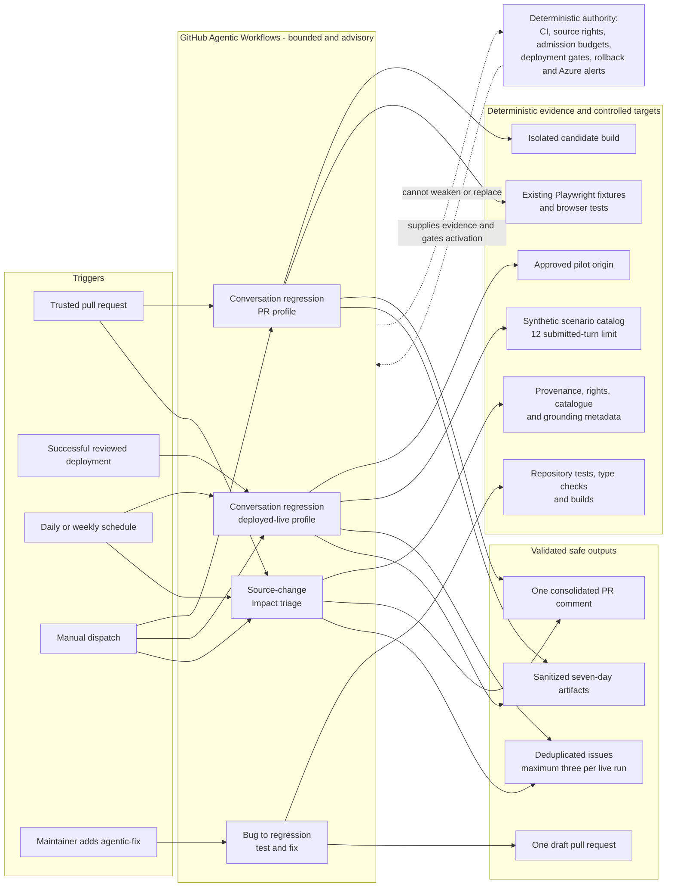

# GitHub Agentic Workflows

This repository uses GitHub Agentic Workflows (GH-AW) for bounded interpretation and
exploration around existing deterministic controls. The authored Markdown files in
`.github/workflows` are the source of truth; their generated `.lock.yml` files are
checked in and must not be edited manually.

## Workflows

| Workflow | Activation | Write surface |
|---|---|---|
| Conversation regression: PR | Trusted same-repository pull requests and manual runs | One advisory PR comment and sanitized artifacts |
| Conversation regression: live | Approved successful deployment, daily, or manual | Up to three deduplicated issues/comments and sanitized artifacts |
| Source impact triage | Source-related pull requests, weekly, or manual | One PR comment or up to three deduplicated issues |
| Bug to regression fix | Maintainer applies `agentic-fix` to an issue | One draft PR or one issue comment |

Ordinary CI remains authoritative for tests, types, builds, containers, and fixed
Playwright assertions. Source acquisition/publication controls, admission budgets,
deployment review, rollback, and Azure alerts are not delegated to agents.

Each workflow also has explicit agent-turn, per-run AI-credit, and per-user daily
AI-credit limits. These are separate from the application's Foundry token and cost
admission controls.

## Architecture



The agent jobs receive read-only repository permissions. GitHub applies issue,
comment, artifact, and draft-PR writes in separate safe-output jobs with explicit
limits. The live profile activates only when the approved URL variables are set; a
post-deployment run must also validate the deployment marker's operation, repository,
run ID, commit, and environment.

## Required repository setup

1. Enable GitHub Actions and GitHub Agentic Workflows for the repository.
2. Allow the Copilot engine through `copilot-requests: write`, or configure the
   documented `COPILOT_GITHUB_TOKEN` fallback if repository policy requires it.
3. Create repository variables:
   - `QA_LIVE_ENABLED`: set to `true` only after the recurring synthetic run is approved.
   - `QA_LIVE_BASE_URL`: exactly
     `https://bcassist-xufhsendpx-ddabgxfdera9azbp.b01.azurefd.net`.
4. Create the `agentic-fix` label before enabling the opt-in fix workflow.
5. Keep the existing `pilot` environment approvals and Azure deployment variables
   unchanged. Live QA does not need Azure provisioning credentials.

If the live target changes, update the workflow's explicit network allowlist and the
validated variable together in a reviewed pull request. Arbitrary dispatch URLs are
intentionally unsupported.

## Development

Install and authenticate the `gh aw` CLI, then compile and validate:

```powershell
gh aw compile --strict --validate --actionlint --shellcheck
gh aw list
```

The repository is pinned by the generated lock files to the action revisions selected
by the installed compiler. Review compiler upgrades and recompile rather than editing
generated YAML.

Run local deterministic support checks:

```powershell
npm run test:tooling
npm run check
```

The live scenario catalog is
`data/evaluations/agentic-conversation-smoke.json`. Every submitted live chat turn,
including retries, must reserve budget through `scripts/agentic-qa-budget.mjs`.

## Outcome semantics

Reports use: pass, confirmed failure, needs review, blocked/incomplete, and not
applicable. A completed workflow or unavailable dependency is not automatically a pass.

Evidence must be synthetic and sanitized. Do not upload complete model transcripts,
Playwright traces containing request bodies, cookies, authorization headers, browser
storage, credentials, or personal information. Default artifact retention is seven
days.

## Rollout

1. Compile and manually trial the PR conversation profile with staged safe outputs.
2. Enable trusted same-repository PR activation.
3. Approve the live target and set `QA_LIVE_ENABLED=true`; run one manual live trial.
4. Enable deployment and daily live triggers.
5. Trial source-impact triage.
6. Create the `agentic-fix` label and enable opt-in draft fixes.

Do not enable a later step until the previous workflow's output, deduplication, budget,
and redaction behavior have been reviewed.
