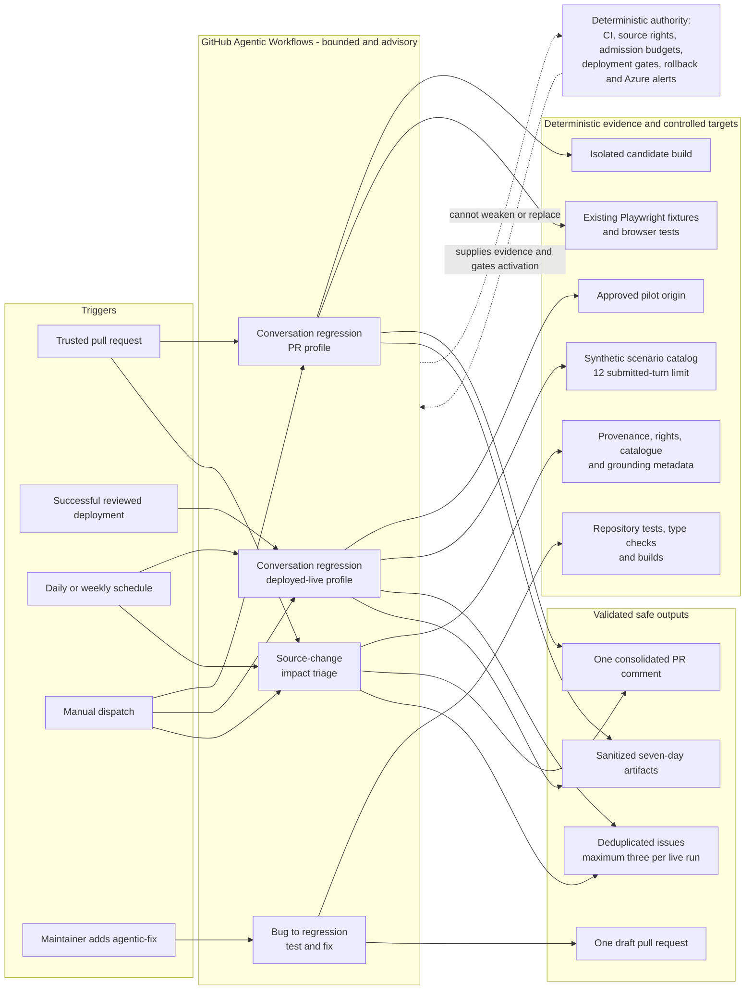
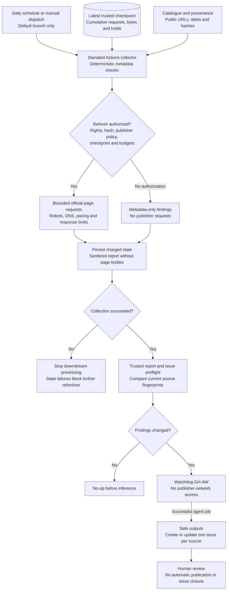
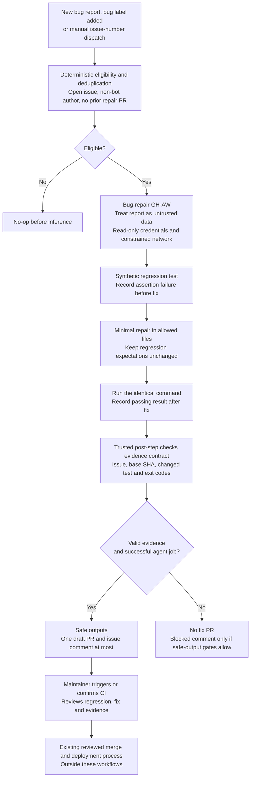

# GitHub Agentic Workflows

This repository uses GitHub Agentic Workflows (GH-AW) for bounded interpretation and
exploration around existing deterministic controls. The authored Markdown files in
`.github/workflows` are the source of truth; their generated `.lock.yml` files are
checked in and must not be edited manually.

This guide covers coding-agent evaluations, conversation QA and the
source-watchdog/automatic-repair workflows. Their triggers and authentication
differ: the QA and coding-evaluation workflows use
`copilot-requests: write`; the watchdog and automatic repair use
`COPILOT_GITHUB_TOKEN`. See each setup section before activation.

## Workflows

| Workflow | Activation | Write surface |
|---|---|---|
| BC Gov Agents - PR Conversation QA | Trusted same-repository pull requests and manual runs | One advisory PR comment and sanitized artifacts; fixture-only, no live model |
| BC Gov Agents - Live Conversation QA | Approved successful deployment, daily, or manual | Up to three deduplicated issues/comments and sanitized artifacts from bounded live synthetic QA |
| BC Gov Agents - Source Impact Review | Source-related pull requests, weekly, or manual | One PR comment or up to three deduplicated issues mapping source changes to user-facing claims |
| BC Gov Agents - Conversation Bug Fix (Opt-in) | Maintainer applies `agentic-fix` to an issue | One draft conversation/browser fix PR or one issue comment |
| BC Gov Agents - Source Freshness Triage | Successful default-branch source collection | Up to twelve source issues created or updated from the trusted report; no publisher fetches |
| BC Gov Agents - Bug Fix (Automatic) | New bug report, `bug` label, or manual dispatch | One draft regression/fix PR and one issue comment |
| BC Gov Agents - Coding Agent Evals | Relevant trusted PRs, daily, or manual | Blocking deterministic check, sanitized results and bounded synthetic code artifacts; no issues or PRs |

These are workflow display names, not new workflow IDs. Existing Markdown
filenames and CLI entry points remain stable. Explicit `run-name` metadata
identifies the relevant event, PR, issue, ref, or collection run. Compiler-owned
jobs retain their standard stages: activation checks eligibility, agent performs
the bounded work, detection checks the output, safe outputs applies permitted
writes, and conclusion reports the result. Those stages are not app test suites.
The coding-evaluation workflow additionally runs an independent
**BC Gov Agents - Coding Agent Eval Gate** job.

The separate **BC Gov Automation - Tooling & Workflow Validation** workflow runs
repository tooling tests and validates definitions in independent jobs; it does
not execute the agents. **BC Gov Sources - Collection** is the deterministic
collector, not an agent. The complete component CI and operations map is in
[the README](../README.md#checks).

`bug-to-regression-fix.md` is the opt-in conversation repair workflow.
`bug-regression-fix.md` is the separate automatic bug-report workflow documented
below. Applying both `bug` and `agentic-fix` can activate both; they do not share
a cross-workflow deduplication gate. Source-impact triage analyzes repository
changes, while the watchdog consumes deterministic freshness reports.

Ordinary CI remains authoritative for tests, types, builds, containers, and fixed
Playwright assertions. Source acquisition/publication controls, admission budgets,
deployment review, rollback, and Azure alerts are not delegated to agents.

Each workflow also has explicit agent-turn, per-run AI-credit, and per-user daily
AI-credit limits. These are separate from the application's Foundry token and cost
admission controls.

## Architecture



The agent jobs receive read-only repository permissions. GitHub applies issue,
comment, artifact, and draft-PR writes in separate safe-output jobs with explicit
limits. The live profile activates only when the approved URL variables are set; a
post-deployment run must also validate the deployment marker's operation, repository,
run ID, commit, and environment.

## Required repository setup

1. Enable GitHub Actions and GitHub Agentic Workflows for the repository.
2. Allow the Copilot engine through `copilot-requests: write`, or configure the
   documented `COPILOT_GITHUB_TOKEN` fallback if repository policy requires it.
3. Create repository variables:
   - `QA_LIVE_ENABLED`: set to `true` only after the recurring synthetic run is approved.
   - `QA_LIVE_BASE_URL`: exactly
     `https://bcassist-xufhsendpx-ddabgxfdera9azbp.b01.azurefd.net`.
4. Create the `agentic-fix` label before enabling the opt-in fix workflow.
5. Keep the existing `pilot` environment approvals and Azure deployment variables
   unchanged. Live QA does not need Azure provisioning credentials.

If the live target changes, update the workflow's explicit network allowlist and the
validated variable together in a reviewed pull request. Arbitrary dispatch URLs are
intentionally unsupported.

## Development

Install and authenticate the `gh aw` CLI, then compile and validate:

```powershell
gh aw compile --strict --validate --no-check-update --actionlint --shellcheck
gh aw list
```

The repository is pinned by the generated lock files to the action revisions selected
by the installed compiler. Review compiler upgrades and recompile rather than editing
generated YAML.

Run local deterministic support checks:

```powershell
npm run test:tooling
npm run check
```

The live scenario catalog is
`data/evaluations/agentic-conversation-smoke.json`. Every submitted live chat turn,
including retries, must reserve budget through `scripts/agentic-qa-budget.mjs`.

## Outcome semantics

Reports use: pass, confirmed failure, needs review, blocked/incomplete, and not
applicable. A completed workflow or unavailable dependency is not automatically a pass.

Evidence must be synthetic and sanitized. Do not upload complete model transcripts,
Playwright traces containing request bodies, cookies, authorization headers, browser
storage, credentials, or personal information. Default artifact retention is seven
days.

## Rollout

1. Compile and manually trial the PR conversation profile with staged safe outputs.
2. Enable trusted same-repository PR activation.
3. Approve the live target and set `QA_LIVE_ENABLED=true`; run one manual live trial.
4. Enable deployment and daily live triggers.
5. Trial source-impact triage.
6. Create the `agentic-fix` label and enable opt-in draft fixes.

Do not enable a later step until the previous workflow's output, deduplication, budget,
and redaction behavior have been reviewed.

## Coding-agent evaluations in CI

`coding-agent-evals.md` evaluates the **software-building agent**, not the
application's answers. It uses Copilot and imports
`shared/coding-agent-policy.md`, also imported by the automatic bug-repair
workflow. Both use the existing `GH_AW_MODEL_AGENT_COPILOT` /
`GH_AW_DEFAULT_MODEL_COPILOT` model selection, with `auto` as the fallback.
Workflow-specific issue handling, GitHub writes and the entire repair workflow
are not simulated by this starter suite.

The versioned catalog is `data/evaluations/coding-agent/suite.json`. Its six
frozen, deliberately broken module extracts come from existing repository
behavior and regression tests:

| Task | Required outcome |
|---|---|
| Strict ports | Reject partial parses, malformed inputs and out-of-range ports without replacing them with defaults |
| Loopback settings | Keep local URLs on loopback and reject port collisions |
| Checkpoint continuity | Preserve the newest eligible charged attempt, including failures, cancellations and in-progress runs |
| Bug deduplication | Do not create another repair after a matching bot PR closes or merges |
| Repair evidence | Require assertion failure before, success after, matching issue/commit and a changed regression |
| Current fingerprint | Distinguish the current source finding from historical fingerprints without weakening ownership checks |

These are synthetic coding tasks, not live incidents or resident data. The
initial coverage is intentionally small, not a claim to benchmark every
language, browser task or SDLC stage. Tasks share one bounded coding-agent
session; grading executes each solution separately.

### Execution and the gate

1. A cheap pre-activation check examines changed filenames, including previous
   names on renames. Changes to `.github/**`, root `AGENTS.md`/`CLAUDE.md`, the
   evaluation harness, catalog or checks activate inference. All PRs create a
   workflow run, so unrelated PRs skip the gate as not applicable rather than
   leaving a path-filtered required check pending. Failed scope discovery is
   not treated as an irrelevant change.
2. A deterministic preparation job packages only instructions, frozen tasks
   and public smoke checks. The agent receives that task-only workspace, not a
   checkout: production implementations, Git objects/history and private grading
   checks are absent. It can repair only the prepared candidate modules. GitHub
   tools and external network access are disabled; no package installation,
   app services, Foundry calls or production credentials are needed.
   Shell permissions use Copilot's command-prefix syntax (`node --test:*` and
   `node --check:*`), not filename globs in permission rules. This authorizes
   the public smoke command and individual test/syntax checks without granting
   arbitrary Node execution or unrestricted shell access. File-change boundaries
   remain enforced by the protected-input collector and independent grader.
3. Before inference, Actions fingerprints the protected inputs. Afterward a
   hash-checked collector rejects missing, oversized or linked files and
   records any changes to protected instructions, fixtures or public tests.
   The agent does not supply the score or the collector's metadata.
4. A separate job checks out the same immutable commit and downloads only
   this run's bounded candidate artifact. Each candidate executes inside a
   digest-pinned Node 24 container with no network, credentials, Docker socket
   or repository mount. It runs non-root with read-only files, a 15-second
   deadline and CPU, memory and process limits. Expected results remain
   outside the container; an exit code of zero or an agent's success claim
   cannot substitute for correct returned outcomes.
5. The initial threshold is **100%: all six tasks must pass all their normal,
   boundary and negative checks**. Missing submissions, altered protected
   files, failed/skipped inference, unavailable grading infrastructure or
   cleanup failures produce a blocked/incomplete result and a failing gate.
   There is no automatic retry or success-shaped fallback.

The gate compares against fixed acceptance criteria, not an automatically
changing historical average. `coding-agent-eval-report` contains sanitized
JSON and Markdown with per-task results, pass rate, threshold, tested commit,
requested model, suite/configuration fingerprints and grading-image digest.
The job summary shows the same results. Reports and bounded synthetic candidate
files are retained for seven days; they do not contain raw model transcripts,
request bodies or credentials. GH-AW retains its own framework diagnostics.
With `auto`, the report records that requested selector rather than inventing
the resolved model; consult the native run diagnostics for engine details.

### Activation, cost and extension

Use the existing Copilot inference permission setup. Same-repository,
authorized PRs are supported; fork PRs do not get a billable trial. The daily
schedule detects model/default drift even without a configuration commit, and
`workflow_dispatch` permits a deliberate rerun. Repository-variable changes do
not emit a PR event: dispatch an eval when changing model selection rather than
waiting for the next daily run.

The agent is bounded to 60 turns, 300 AI Credits/run, 900/day and 20 minutes.
The independent grading job has a ten-minute limit. Framework detection and
Actions compute remain separate costs. Budget exhaustion is not a pass. No
automatic issues, comments, draft PRs, merge, deployment or application-model
evaluations are configured.
The pinned compiler automatically supplies an issue safe-output even for
noop-only workflows. Safe outputs are therefore explicitly **staged**, and
failure/incomplete tracking is disabled where supported, so those framework
tools cannot publish an issue. Staging does not soften the independent CI gate
or prevent its deterministic artifact uploads.

After the workflow is merged and a live trial is reviewed, require
**BC Gov Agents - Coding Agent Eval Gate** in the repository's merge rules if
merges must be prevented on failure. Committing these files does not modify
branch protection. A skipped unrelated/fork run is not evidence that the agent
was evaluated. This gate must not be used as evidence for untrusted fork
configuration changes.

Add a permanent case after a relevant incident: include a synthetic frozen
starter, a clear contract with public smoke examples, and independent positive,
boundary and counterexample checks in `tests/agent-evals/checks.mjs`. Review
changes to expected outcomes and thresholds like production controls. The
tooling suite proves every starter fails and the repository's accepted
implementation passes; it also exercises tampering and incomplete-run failures.
It does not invoke a model.

```powershell
node --test scripts\tests\coding-agent-evals.test.mjs scripts\tests\ci-workflows.test.mjs
gh aw compile --strict --validate --no-check-update
```

Compilation and local harness checks do not prove a live agent run or hosted
container grading succeeded. Do not dispatch billable trials as part of ordinary
authoring validation.

## Source watchdog and automatic bug repair

These workflows propose reviewable work. They never merge, deploy, publish
source content, approve rights, or run the application's live model evaluations.
They become active after their compiled workflows reach the default branch and
the repository's Actions and inference configuration permits them to run.

## Workflow diagrams

These are repository-maintenance flows, not part of a resident's chat request.
Standard Actions performs deterministic collection; GH-AW agents interpret
findings or propose fixes. Only separate safe-output jobs can write issues or
draft PRs, and only after the agent job succeeds.

### Source collection and freshness triage



Missing rights permit metadata checks, not network acquisition. Invalid rights
or broken checkpoint continuity fail closed. Private rights and response bodies
do not enter the agent context; changed response bytes are not proof of a
semantic policy change.

### Bug report to regression test to fix



Evidence checks validate the recorded contract, not independent execution of
the claimed commands. Draft fixes cannot modify protected workflow, deployment,
rights or other excluded files. Neither workflow merges, deploys or calls the
application's live models. Default-token-created PRs do not automatically start
PR CI.

## Source watchdog and automatic repair setup

1. Enable GitHub Actions and allow Actions to create pull requests in the
   repository's workflow-permission settings. The agent jobs remain read-only;
   separate GH-AW safe-output jobs receive the write permissions they require.
2. Configure `COPILOT_GITHUB_TOKEN` using the
   [GH-AW Copilot authentication instructions](https://github.github.com/gh-aw/reference/engines/#github-copilot-default).
   These definitions use PAT-based inference (`copilot-requests: none`), not
   centralized Copilot billing. Never put this token in issue content or code.
3. Ensure the `bug` label exists. The issue form applies it; the form's
   `[Bug]:` title and `Bug report` field also identify newly opened reports
   if that label is unavailable. No maintainer approval label is required.
4. For authorized network refreshes only, supply the existing programme-bound
   schema-v2 candidate rights document as `SOURCE_WATCHDOG_RIGHTS_JSON`, a
   repository secret. Set repository variable `SOURCE_WATCHDOG_RIGHTS_SHA256`
   to the SHA-256 of that exact UTF-8 string, including any trailing newline.
   The workflow does not provide or manufacture an approval. A public URL,
   robots allowance, or historical snapshot does not constitute permission.
5. Dispatch **BC Gov Sources - Collection** with `initialize: true` once actual
   rights are configured, or run it without initialization for metadata checks.
   Initialization is accepted only when trusted state explicitly establishes
   that no checkpoint has ever been initialized. It cannot reset existing quotas.

Missing rights produce explicit `rights-review-required` findings and no
publisher requests. Invalid rights/hash inputs fail collection. Expired/revoked
rights produce explicit blocked findings. Neither case becomes a clean freshness
result. Renewing a valid review preserves existing cumulative budgets.

## Source freshness flow

`official-source-collection.yml` runs daily at 13:23 UTC and on manual dispatch,
only on the default branch, displayed as **BC Gov Sources - Collection**.
The downstream `official-source-watchdog.md`, displayed as **BC Gov Agents -
Source Freshness Triage**, assesses its successful, trusted report.
The downstream trigger is restricted to `main`, the current default branch;
update that filter and recompile if the repository's default branch changes.

The collector runs repository-owned Python before any agent inference. It
checks the exact catalogue/provenance URLs, source check dates and baseline
hashes, and maps each source to affected journeys. The stale threshold is
30 days. It does not recursively crawl, follow arbitrary links, retrieve forms,
authenticate to publishers, or discover new content.

An HTML refresh must satisfy both the narrow existing publisher policy and
`ProgrammePolicy`'s current rights checks. Existing ICBC, WorkBC, and legal-source
holds are not cleared by the watchdog. Feed/rendered/legal-route grants do not
authorize ordinary HTML requests. Existing DNS pinning, HTTPS, robots,
same-host redirects, response bounds, and pacing remain in use.

The dedicated checkpoint has lifetime limits of **1,000 HTTP requests and
64 MB charged bytes**. Each invocation allows at most 25 requests, including
robots and redirects, within a 90-second acquisition window, with a 1-MB page
bound and 15-second request timeout. Requests/bytes are charged before dispatch;
interrupted requests retain their reservation. There are no immediate retries.
Valid `Retry-After` deadlines are persisted; later invocations must honor them.
Invalid `Retry-After` values persist a host hold requiring publisher review.
Pages are attempted in oldest-successful-observation order to reduce starvation.
HTTP 304 is unverifiable because this monitor does not send conditional
validators; it never invents unchanged content without comparing full bytes.

The `official-source-state` artifact holds only the checkpoint or an explicit
never-initialized marker and is retained for 90 days. Each run restores the
exact most recent eligible default-branch collection attempt, never an older
successful fallback. Runs are serialized. Failed collection still uploads
charged state when restoration succeeded. Re-running an existing run attempt
is refused; use a new dispatch instead.

The display-name migration preserves historical checkpoint continuity:
`previousCollection` recognizes both the new collector name and the exact former
`Official source collection` name, with the same path/repository/branch/event
checks. Only historical lookup accepts the old name; current collector runs and
new watchdog events require the canonical name. Keep the workflow filename,
serialization group, and state/report artifact names unchanged. A rename is
never permission to reinitialize or discard charged state.

If state is missing, expired, malformed, or upload continuity fails, subsequent
network refreshes stop. Do not delete the checkpoint, use an older artifact, or
initialize a replacement to evade exhausted budgets. A maintainer must recover
the latest authoritative charged state and review the interrupted run; if that
state is unrecoverable, network collection stays blocked. Programme/limit changes
also require explicit review rather than silently migrating/resetting accounting.
Offline metadata inspection remains available locally.

The seven-day `official-source-report` artifact and agent context contain only
public URLs, IDs, dates, status/finding codes, hashes, and journey references.
Response bodies and private rights documents are never persisted or passed
to the agent. A changed hash indicates changed response bytes, not necessarily
changed policy; the agent must not invent a semantic content diff.

The agent has no publisher-network access. It maintains one persistent issue
per source, with `bc-source-watchdog:SOURCE_ID` and finding-fingerprint markers.
Unchanged fingerprints are a deterministic no-op before inference. Changed
findings update the existing issue body and retain two previous concise summaries
(earlier bodies remain in GitHub edit history); closed issues
are updated without reopening them. Duplicate matching issues require manual
reconciliation. It never automatically closes tickets or labels them `bug`.
At most twelve source issues may be created/updated per run.

## Bug report to regression test to draft PR

The bug form, a newly opened issue bearing `bug`, or addition of that label
starts eligibility checking. Manual dispatch accepts an open issue number.
Bot-authored reports, non-bugs, closed reports, edits, and issues with an existing
bot-authored repair PR are skipped before inference. Closed/merged repair PRs
also prevent duplicate attempts; a genuinely new regression should be a new
report. There is no automatic historical-backlog scan.

Issue-number concurrency and the `bc-bug-fix:NUMBER` PR marker prevent duplicate
repairs. Default-branch code handles the report; no reporter-supplied branch,
attachments, commands or links are executed as instructions. Reports may come
from untrusted authors (`roles: all`, `min-integrity: none`) intentionally, so
the workflow uses synthetic reproductions, constrained network access, and
read-only agent credentials.

The agent must add a regression, demonstrate its assertion failure before
changing production code, repair the root cause without changing the test's
expectations, and show that the identical command passes afterward. A required
evidence record contains the issue/base SHA, changed regression files,
command, exit codes, and bounded failure/success summaries. A post-step checks
this evidence contract before safe outputs are allowed. This is a validation of
recorded evidence, not independent proof that an AI-generated explanation is true;
maintainer review and CI remain necessary.

No reproduction, missing setup, unsafe scope, failed tests or budget exhaustion
means a blocked/inconclusive comment, not a fix PR. The workflow allows only
one draft PR and one issue comment per run. A structural file allowlist and
`protected-files: blocked` prevent workflow/infra/manifest/source-approval edits.
API repairs use an explicit runtime-module allowlist, excluding agent
publication, agent definitions, configuration, authentication and budget modules.
Ingestion repairs are limited to extraction/adapter/location modules and tests.
There is no merge, ready-for-review, source publication, cloud or live-model tool.

PRs use non-closing issue references and record local checks and limitations.
The default `GITHUB_TOKEN` does **not** automatically trigger subsequent PR CI.
An authorized maintainer must trigger/confirm remote CI before reviewing or
merging. This implementation deliberately does not install a broader CI-trigger
PAT or enable auto-merge.

## Limits, maintenance and local verification

Watchdog inference is limited to 20 turns, 100 AI Credits/run, 200/day and a
10-minute engine timeout. Bug repair uses 60 turns, 300 AI Credits/run,
900/day and a 25-minute timeout. Actions minutes and engine inference are
separate costs. GH-AW's threat-detection/conclusion jobs have additional
framework budgets; these limits are not an application Foundry or Azure invoice
cap. Configure organization/repository billing protections separately.

The pinned compiler version is **v0.89.21**. Edit Markdown, then regenerate
all seven committed lock files; never hand-edit generated YAML:

```powershell
gh extension install github/gh-aw --pin v0.89.21
gh aw compile --strict --validate --no-check-update
node --test scripts\tests\*.test.mjs
$env:PYTHONPATH = (Join-Path $PWD 'ingestion')
.\ingestion\.venv\Scripts\python.exe -m unittest discover -s ingestion\tests -q
.\ingestion\.venv\Scripts\python.exe -m bc_ingestion.freshness
```

The last command is offline. Use the ingestion environment's locked dependencies
from `ingestion\requirements.lock`, not an unrelated global Azure SDK.
**BC Gov Automation - Tooling & Workflow Validation** runs helper and
workflow-contract tests and checks compilation drift across all seven lock files
and the action lock. Separate **BC Gov Web**, **BC Gov API**, and **BC Gov
Ingestion** test workflows run their component suites. No live publisher or
billable agent run is required to validate authoring.

When renaming a workflow, change its `workflow_run.workflows` consumers in the
same change and regenerate their locks. **BC Gov Agents - Live Conversation QA**
listens to **BC Gov App - Azure Deployment**, but still requires a successful
`deploy` marker matching the repository, run, SHA, and environment; successful
`provision` and `verify` operations are not deployments. Keep environment,
tracker, concurrency, issue-marker, and artifact identities stable. Avoid
overlapping old/new executions during cutover, and review required-check
references before rollout; do not delete old run history.

References: [safe outputs](https://github.github.com/gh-aw/reference/safe-outputs/),
[file and draft policies](https://github.github.com/gh-aw/reference/safe-outputs-pull-requests/),
[network boundaries](https://github.github.com/gh-aw/reference/network/),
[cost management](https://github.github.com/gh-aw/reference/cost-management/),
[custom deterministic steps](https://github.github.com/gh-aw/reference/steps-jobs/).
