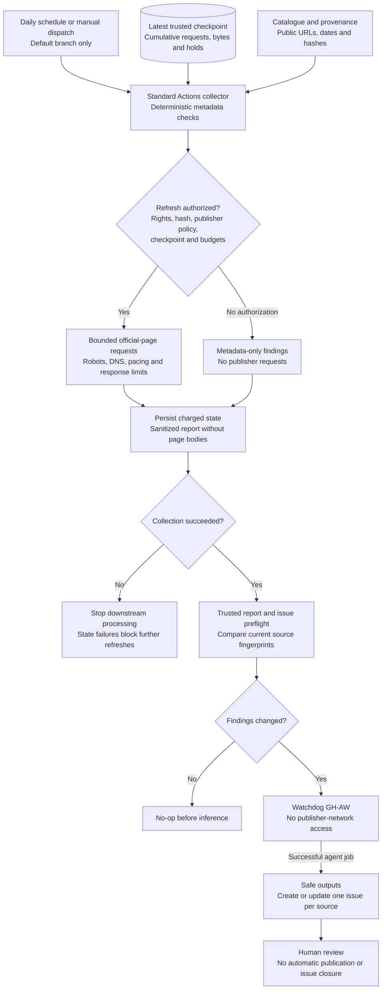
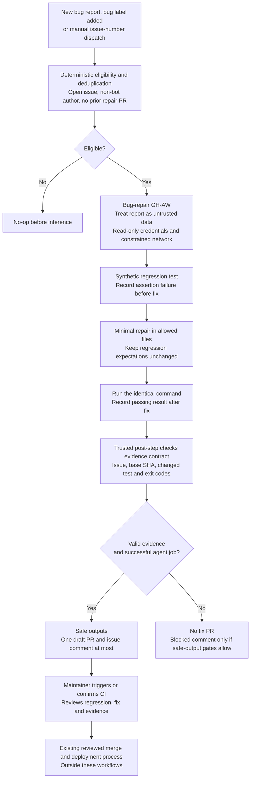

# Source watchdog and automatic bug repair

These workflows propose reviewable work. They never merge, deploy, publish
source content, approve rights, or run the application's live model evaluations.
They become active after their compiled workflows reach the default branch and
the repository's Actions and inference configuration permits them to run.

## Workflow diagrams

These are repository-maintenance flows, not part of a resident's chat request.
Standard Actions performs deterministic collection; GH-AW agents interpret
findings or propose fixes. Only separate safe-output jobs can write issues or
draft PRs, and only after the agent job succeeds.

### Official-source freshness watchdog



Missing rights permit metadata checks, not network acquisition. Invalid rights
or broken checkpoint continuity fail closed. Private rights and response bodies
do not enter the agent context; changed response bytes are not proof of a
semantic policy change.

### Bug report to regression test to fix



Evidence checks validate the recorded contract, not independent execution of
the claimed commands. Draft fixes cannot modify protected workflow, deployment,
rights or other excluded files. Neither workflow merges, deploys or calls the
application's live models. Default-token-created PRs do not automatically start
PR CI.

## Setup

1. Enable GitHub Actions and allow Actions to create pull requests in the
   repository's workflow-permission settings. The agent jobs remain read-only;
   separate GH-AW safe-output jobs receive the write permissions they require.
2. Configure `COPILOT_GITHUB_TOKEN` using the
   [GH-AW Copilot authentication instructions](https://github.github.com/gh-aw/reference/engines/#github-copilot-default).
   These definitions use PAT-based inference (`copilot-requests: none`), not
   centralized Copilot billing. Never put this token in issue content or code.
3. Ensure the `bug` label exists. The issue form applies it; the form's
   `[Bug]:` title and `Bug report` field also identify newly opened reports
   if that label is unavailable. No maintainer approval label is required.
4. For authorized network refreshes only, supply the existing programme-bound
   schema-v2 candidate rights document as `SOURCE_WATCHDOG_RIGHTS_JSON`, a
   repository secret. Set repository variable `SOURCE_WATCHDOG_RIGHTS_SHA256`
   to the SHA-256 of that exact UTF-8 string, including any trailing newline.
   The workflow does not provide or manufacture an approval. A public URL,
   robots allowance, or historical snapshot does not constitute permission.
5. Dispatch **Official source collection** with `initialize: true` once actual
   rights are configured, or run it without initialization for metadata checks.
   Initialization is accepted only when trusted state explicitly establishes
   that no checkpoint has ever been initialized. It cannot reset existing quotas.

Missing rights produce explicit `rights-review-required` findings and no
publisher requests. Invalid rights/hash inputs fail collection. Expired/revoked
rights produce explicit blocked findings. Neither case becomes a clean freshness
result. Renewing a valid review preserves existing cumulative budgets.

## Source freshness flow

`official-source-collection.yml` runs daily at 13:23 UTC and on manual dispatch,
only on the default branch. The downstream
`official-source-watchdog.md` GH-AW assesses its successful, trusted report.
The downstream trigger is restricted to `main`, the current default branch;
update that filter and recompile if the repository's default branch changes.

The collector runs repository-owned Python before any agent inference. It
checks the exact catalogue/provenance URLs, source check dates and baseline
hashes, and maps each source to affected journeys. The stale threshold is
30 days. It does not recursively crawl, follow arbitrary links, retrieve forms,
authenticate to publishers, or discover new content.

An HTML refresh must satisfy both the narrow existing publisher policy and
`ProgrammePolicy`'s current rights checks. Existing ICBC, WorkBC, and legal-source
holds are not cleared by the watchdog. Feed/rendered/legal-route grants do not
authorize ordinary HTML requests. Existing DNS pinning, HTTPS, robots,
same-host redirects, response bounds, and pacing remain in use.

The dedicated checkpoint has lifetime limits of **1,000 HTTP requests and
64 MB charged bytes**. Each invocation allows at most 25 requests, including
robots and redirects, within a 90-second acquisition window, with a 1-MB page
bound and 15-second request timeout. Requests/bytes are charged before dispatch;
interrupted requests retain their reservation. There are no immediate retries.
Valid `Retry-After` deadlines are persisted; later invocations must honor them.
Invalid `Retry-After` values persist a host hold requiring publisher review.
Pages are attempted in oldest-successful-observation order to reduce starvation.
HTTP 304 is unverifiable because this monitor does not send conditional
validators; it never invents unchanged content without comparing full bytes.

The `official-source-state` artifact holds only the checkpoint or an explicit
never-initialized marker and is retained for 90 days. Each run restores the
exact most recent eligible default-branch collection attempt, never an older
successful fallback. Runs are serialized. Failed collection still uploads
charged state when restoration succeeded. Re-running an existing run attempt
is refused; use a new dispatch instead.

If state is missing, expired, malformed, or upload continuity fails, subsequent
network refreshes stop. Do not delete the checkpoint, use an older artifact, or
initialize a replacement to evade exhausted budgets. A maintainer must recover
the latest authoritative charged state and review the interrupted run; if that
state is unrecoverable, network collection stays blocked. Programme/limit changes
also require explicit review rather than silently migrating/resetting accounting.
Offline metadata inspection remains available locally.

The seven-day `official-source-report` artifact and agent context contain only
public URLs, IDs, dates, status/finding codes, hashes, and journey references.
Response bodies and private rights documents are never persisted or passed
to the agent. A changed hash indicates changed response bytes, not necessarily
changed policy; the agent must not invent a semantic content diff.

The agent has no publisher-network access. It maintains one persistent issue
per source, with `bc-source-watchdog:SOURCE_ID` and finding-fingerprint markers.
Unchanged fingerprints are a deterministic no-op before inference. Changed
findings update the existing issue body and retain two previous concise summaries
(earlier bodies remain in GitHub edit history); closed issues
are updated without reopening them. Duplicate matching issues require manual
reconciliation. It never automatically closes tickets or labels them `bug`.
At most twelve source issues may be created/updated per run.

## Bug report to regression test to draft PR

The bug form, a newly opened issue bearing `bug`, or addition of that label
starts eligibility checking. Manual dispatch accepts an open issue number.
Bot-authored reports, non-bugs, closed reports, edits, and issues with an existing
bot-authored repair PR are skipped before inference. Closed/merged repair PRs
also prevent duplicate attempts; a genuinely new regression should be a new
report. There is no automatic historical-backlog scan.

Issue-number concurrency and the `bc-bug-fix:NUMBER` PR marker prevent duplicate
repairs. Default-branch code handles the report; no reporter-supplied branch,
attachments, commands or links are executed as instructions. Reports may come
from untrusted authors (`roles: all`, `min-integrity: none`) intentionally, so
the workflow uses synthetic reproductions, constrained network access, and
read-only agent credentials.

The agent must add a regression, demonstrate its assertion failure before
changing production code, repair the root cause without changing the test's
expectations, and show that the identical command passes afterward. A required
evidence record contains the issue/base SHA, changed regression files,
command, exit codes, and bounded failure/success summaries. A post-step checks
this evidence contract before safe outputs are allowed. This is a validation of
recorded evidence, not independent proof that an AI-generated explanation is true;
maintainer review and CI remain necessary.

No reproduction, missing setup, unsafe scope, failed tests or budget exhaustion
means a blocked/inconclusive comment, not a fix PR. The workflow allows only
one draft PR and one issue comment per run. A structural file allowlist and
`protected-files: blocked` prevent workflow/infra/manifest/source-approval edits.
API repairs use an explicit runtime-module allowlist, excluding agent
publication, agent definitions, configuration, authentication and budget modules.
Ingestion repairs are limited to extraction/adapter/location modules and tests.
There is no merge, ready-for-review, source publication, cloud or live-model tool.

PRs use non-closing issue references and record local checks and limitations.
The default `GITHUB_TOKEN` does **not** automatically trigger subsequent PR CI.
An authorized maintainer must trigger/confirm remote CI before reviewing or
merging. This implementation deliberately does not install a broader CI-trigger
PAT or enable auto-merge.

## Limits, maintenance and local verification

Watchdog inference is limited to 20 turns, 100 AI Credits/run, 200/day and a
10-minute engine timeout. Bug repair uses 60 turns, 300 AI Credits/run,
900/day and a 25-minute timeout. Actions minutes and engine inference are
separate costs. GH-AW's threat-detection/conclusion jobs have additional
framework budgets; these limits are not an application Foundry or Azure invoice
cap. Configure organization/repository billing protections separately.

The pinned compiler version is **v0.89.21**. Edit Markdown, then regenerate
both committed lock files; never hand-edit generated YAML:

```powershell
gh extension install github/gh-aw --pin v0.89.21
gh aw compile official-source-watchdog bug-regression-fix --no-check-update --validate
node --test scripts\tests\*.test.mjs
$env:PYTHONPATH = (Join-Path $PWD 'ingestion')
.\ingestion\.venv\Scripts\python.exe -m unittest discover -s ingestion\tests -q
.\ingestion\.venv\Scripts\python.exe -m bc_ingestion.freshness
```

The last command is offline. Use the ingestion environment's locked dependencies
from `ingestion\requirements.lock`, not an unrelated global Azure SDK. Existing
CI checks compilation drift and runs the new helper/ingestion tests alongside
the original application checks. No live publisher or billable agent run is
required to validate authoring.

References: [safe outputs](https://github.github.com/gh-aw/reference/safe-outputs/),
[file and draft policies](https://github.github.com/gh-aw/reference/safe-outputs-pull-requests/),
[network boundaries](https://github.github.com/gh-aw/reference/network/),
[cost management](https://github.github.com/gh-aw/reference/cost-management/),
[custom deterministic steps](https://github.github.com/gh-aw/reference/steps-jobs/).
