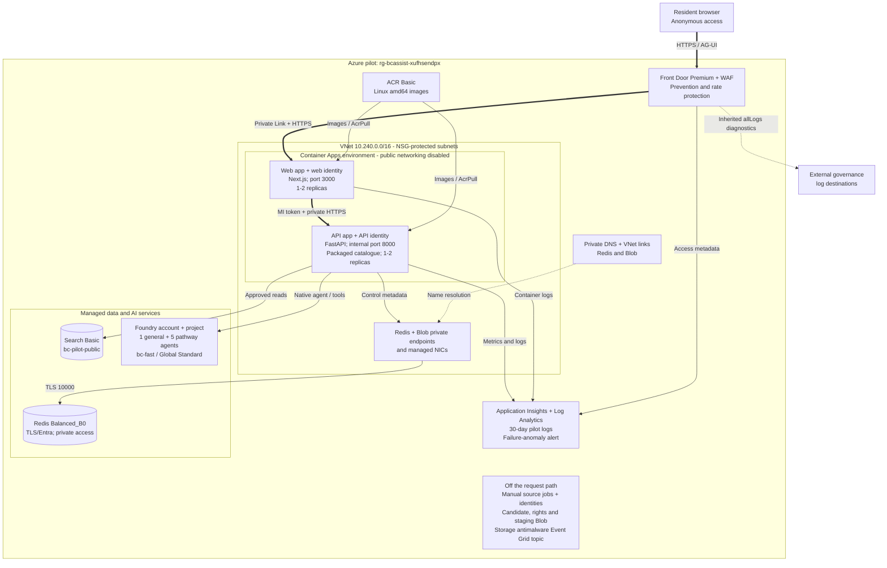
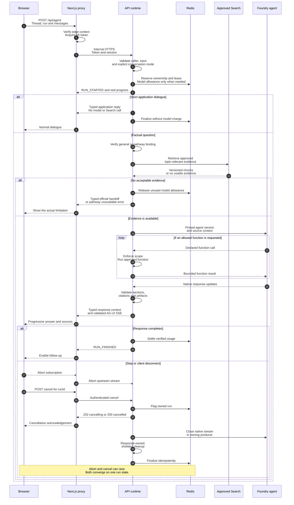
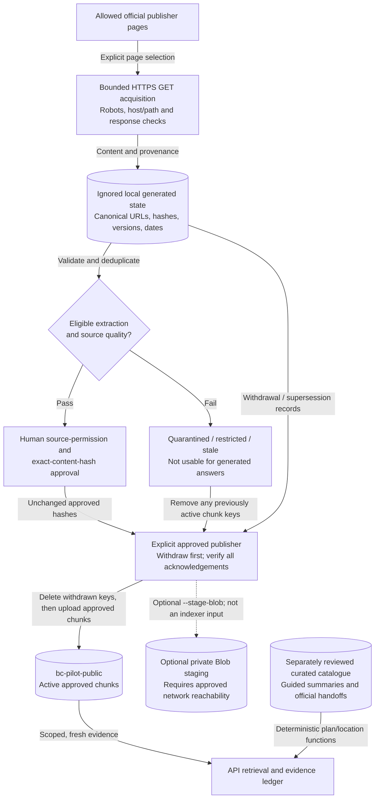

# BC service assistant architecture

**Status:** Version-5 conversation repair deployed and publicly verified November 6, 2026. Anonymous access remains the default. The synthetic citizen-context ADM demo remains available. Broader private full-corpus publication remains disabled.
**Resource group:** `rg-bcassist-xufhsendpx`
**Subscription:** `ME-MngEnvMCAP744360-sharmave-1`
**Primary resource region:** Canada Central; Front Door, WAF and private DNS are global resources.
**Public site:** https://bcassist-xufhsendpx-ddabgxfdera9azbp.b01.azurefd.net/

**Incident observation (November 5, 2026):** The public app advertised request
versions 1--3. Its 12 Search chunks came from four October 25 checks outside
the seven-day evidence window. The exact
renewal request and a previously covered Health Connect Registry question both
returned application-authored source-gap handoffs. The authorized November 6
restoration deployed the version-5/task configuration and refreshed the same
four reviewed documents. Source readiness now validates usable evidence rather
than merely counting indexed documents. Deployment and acceptance records below
distinguish the current release from earlier public checks.

This document describes the deployed application and the current repository,
not the larger target architecture in the [original specification](pilot-specification.md).
The assistant provides official information, preparation plans and handoffs.
It does not renew licences, book appointments, submit forms, make payments or
decide a resident's eligibility.

The separately approved
[citizen-context ADM validation demo](citizen-context-demo.md) is deployed in
the public pilot with fixed synthetic personas. It keeps anonymous access as the default,
uses only three fixed fictional personas, and stops at a preview, consent
checkpoint, and official handoff. The
[ADM demonstration package](citizen-context-adm-demo.md) and
[executive brief](citizen-context-executive-brief.md) support a decision
session without claiming real citizen integration. The production identity and Context Broker
section is a future contract, not evidence of a live BC Services Card,
government-record, or Entra Agent ID integration. The
[production citizen identity and data-access specification](citizen-context-identity.md)
defines that future contract's implementation boundaries and external approval
gates; it does not describe deployed resources.

The public website needs no citizen sign-in. Its backend uses Microsoft Entra
managed identities, a private application origin and a reviewed Search corpus.
Azure-native hosting does **not** mean every service endpoint is private or that
Global Standard model processing stays in Canada.

Repository maintenance is separate from the resident request path. The
[agentic workflows guide and diagrams](agentic-workflows.md#workflow-diagrams)
describe the official-source freshness watchdog and bug-report-to-draft-fix
automation, including deterministic checks, agent boundaries and human review.
These workflows require repository activation; they are not deployed Azure
services and cannot publish sources, merge fixes or deploy the application.

## 1. System overview

There are two complementary experiences:

- **Guided plans:** deterministic journeys and office information from the
  packaged `data/pilot-catalog.json`. These are not model-generated answers.
- **General chat:** the default B.C. government conversation, with one general
  Foundry agent and optional explicit pathway scope. Application greetings need
  no model or retrieval. Factual answers require approved evidence; missing
  topics receive an honest official handoff, not an answer from model memory.

| Component | Implementation | Responsibility |
|---|---|---|
| Website | Next.js, React, TypeScript; Node.js 24 | BC interface, themes, tab-memory conversation and guided plans |
| Chat client | `@ag-ui/client` `HttpAgent` | Same-origin HTTP POST/SSE; the application reducer owns presentation |
| Web backend-for-frontend | Next.js route proxy and `@azure/identity` | Allowlisted API forwarding, trusted edge context and managed-identity authentication |
| Application API | FastAPI, Python 3.14, Microsoft Agent Framework | Routing, native agent/tool execution, evidence validation and run lifecycle |
| AI service | Foundry Agent Service; isolated conversation, general and seven pathway prompt agents | Stored instructions, declared tools and pinned model bindings |
| Model | `bc-fast`: `gpt-5.4-mini`, `2026-03-17`, `GlobalStandard` | Azure-hosted inference; model auto-upgrade is disabled |
| Grounding | Azure AI Search Basic, `bc-pilot-public` | Approved document chunks; lexical/configured semantic retrieval, not live web search |
| Shared controls | Azure Managed Redis `Balanced_B0` | Session ownership, atomic limits, leases, cancellation and estimated-cost accounting |
| Content operations | Independent Python ingestion package and bounded manual Container Apps Jobs | Explicit initialization, acquisition, review, validation, publication and withdrawal |
| Delivery and operations | Azure Container Apps, ACR, Front Door, Azure Monitor | Application hosting, protected ingress, images and operational evidence |

There is no dependency on Vercel hosting, Vercel AI Gateway, CopilotKit Cloud
or a third-party model gateway. Foundry agents are managed **prompt agents**,
not additional application containers. A version-5 turn can use the isolated
planner for structured routing, then a selected factual agent if reviewed
evidence is needed. Deterministic answers and task controls need no model.
Requests do not fan out to every agent.

## 2. Deployment and trust boundaries

The diagram groups supporting resources to keep the request path readable.
The inventory below enumerates the individual resources and important children.
Thick arrows are the primary request path; dashed arrows are conditional or
administrative relationships, not additional live AI capabilities.

### Public edge versus private application origin

Front Door routes HTTPS `/*` to the web app through the approved private-link
connection to the Container Apps environment. The origin host and host header
match, certificate-name checking remains enabled, and route caching is not
configured. SSE responses also carry `no-store`/no-buffering headers.

The WAF's temporary `ValidationOnly` IP rule was removed for public release.
Managed protection and the `ApiRateLimit` rule remain. A WAF protects this public
service; it is not a citizen authentication mechanism.

The web Container App has `external: true` ingress **within an environment whose
public network access is disabled**. This is not a direct public-origin bypass.
The API has internal ingress. The VNet has no peering to the separate
internal-production BC environment.

| Subnet | Address range | Purpose |
|---|---|---|
| `apps` | `10.240.0.0/23` | Delegated to `Microsoft.App/environments`; apps-subnet NSG attached |
| `private-endpoints` | `10.240.4.0/24` | Redis and Blob private endpoints/NICs; private-endpoints NSG attached |

### PaaS boundaries and policy-managed configuration

| Service | Observed network/authentication boundary |
|---|---|
| Foundry | Public service endpoint enabled; local/key authentication disabled; Entra-authorized requests |
| Search | Public service endpoint enabled; local/key authentication disabled; Entra-authorized data operations |
| Redis | Public access disabled; private endpoint/DNS; encrypted port 10000; key authentication disabled |
| ACR | Public endpoint enabled; registry administrator account disabled; managed-identity pulls |
| Blob source/staging storage | Public network access disabled; Blob private endpoint/DNS verified; shared keys, bypass and public containers disabled |

Blob storage is **not** an API dependency. The candidate and rights containers
use the verified private path for manual source operations. The separate
`reviewed-content` container remains optional staging; Search publication does
not require `--stage-blob`.

Live policy-managed settings can differ from template defaults. In particular,
the storage network restriction, subnet NSG associations, storage antimalware
subscription and inherited diagnostics must not be omitted or portrayed as
application-created workflows. This documentation does not change those settings.

## 3. Chat, grounding and cancellation

### Source health and release restoration

The version-5 planner/task flags and its distinct pinned binding are now carried
through the deployment templates and protected workflow, with disabled defaults
and an actual public privacy-review prerequisite. Intended conversation releases
must verify live capability negotiation rather than accepting a healthy legacy
deployment as equivalent.

The web shell reads its two public feature flags at request time, rather than
baking them into the container build. This lets a cold-page Send select the
intended version-5 contract immediately while readiness is still being checked.
The hint does not claim that a model or evidence source is ready; the API still
enforces activation, privacy, admission, and binding checks. Protocol/task
selection stays pinned for the page conversation, including after a capability
request fails, and sharing controls remain non-model operations.

Source readiness uses the same row validator as factual retrieval, including
publisher/URL provenance, metadata eligibility, content validation, and source
age. A bounded non-model scan reports usable/expired documents, rejected chunks,
source coverage, and the next expiry through `sourceHealth`. It scans no more
than 1,000 active allowed-source chunks; an incomplete or failed scan reports an
explicit error, not success based on a partial sample. The cache cannot outlive
the next evidence expiry. Neither a successful query nor pathway readiness can
overwrite this health assessment with a document-count shortcut.

When metrics and Search are configured, an owned lifespan task checks source
health on startup and every five minutes, even with no user traffic. It records
`bc.sources.checked` operational events and `bc.sources.checks`,
`bc.sources.usable_documents`, and `bc.sources.hours_to_expiry` metrics. Operators
should investigate zero usable documents, failed checks, or an expiring status;
missing telemetry is not a healthy check. This task performs no model/embedding
calls, acquisition, publication, or automatic date updates.

Detailed factual generation still requires current evidence. Version-5
preparation remains available through the existing catalogue/task coordinator
when Search lacks the relevant detail. Its handoff preserves task progress and
names the specific source gap. Legacy driver/drivers/driver's wording also keeps
the appropriate ICBC renewal links instead of falling back to the government
homepage.
Additional-requirements questions preserve reviewed task progress. A planner
echo of an already-confirmed municipality is a no-op, while a genuinely new
municipality still needs support in the current message.

`scripts\verify-pilot-chat.mjs` and the protected workflow's `verify` operation
check this release contract. Explicitly approved live verification additionally
tests the reported renewal continuation, the non-B.C. route, starter navigation,
and a genuinely cited health response. A 200 response with a generic refusal is
a failed outcome.

### Local grounded conversation (version 6)

The opt-in local profile uses distinct planner/writer bindings and a typed
programme source reader. It separates the person's current question from
preparation progress, preserves explicit EI/adult/child/PWD context, and
keeps canonical answers and necessary follow-ups application-owned. It does
not expose legacy plan/office tools to the grounded writer or send private
context into free-text retrieval queries.

Named licensed statutory reads, existing project notes and integrity-pinned,
dated Canada.ca copies are a separate local non-commercial evaluation source
profile. They are not publication approval for the original source blueprints.
Both services remain loopback-only; metadata and UI disclose provenance,
copyright/licence notices and the evaluation restriction.

Core factual answers are buffered until source validation succeeds, with at
most one output-only correction inside the original model budget. Progress
and usage remain visible/accounted; rejected text is not emitted or saved.
The producer still owns and closes the native response stream on cancellation.
Other journeys retain their existing general-agent/tool contract, and
version-5 incremental validation is unchanged.

### Repository-only context-first increment

The subsequent AI-led mode is gated by `AI_CONVERSATION_ENABLED` and request
version 5. It uses an isolated `FOUNDRY_CONVERSATION_AGENT`, not an edit to the
public general or pathway agents. After admission, a single bounded Responses
API call to the pinned prompt agent returns one strict function proposal.
The server validates it, emits reviewed conversational wording, selects a
canonical preparation guide, or invokes the existing grounded-answer runtime.
Planning and answer generation share one `ModelBudget`; inference does not
become free merely because the displayed text is application-rendered.
Privacy commands, replayed results, and canonical answers to pending questions
require no fresh inference. All other model work still goes through admission.

Version-5 state has its own page binding, notice, namespace, expiry, and revision
contract. It contains minimized user-stated categories, not a raw transcript.
The optional sharing control starts off. When on, relevant personal context
may enter model reasoning but never the public Search query or embeddings.
Version 4 retains its stronger no-personal-answers-to-model rule, and its data
is not imported into version 5. Provider conversation storage remains disabled.
Model changes, endpoint errors, and lost metadata cannot silently fall back to
a fake successful AI answer.

The server renders accepted decision types rather than arbitrary uncited
planner prose. Essential questions use reviewed vocabulary. An unconfirmed
model guess cannot count as an answer to an essential question. Model-selected
navigation updates require an exact current-message quote and bounded value
checks; personal fields additionally require sharing permission and explicit
value evidence. A category remains self-reported, never a government fact.
Full factual claims continue through the existing evidence verifier.

Question definitions also own canonical value/label decoding. A whole explicit
answer is resolved during preparation, after page/question/revision checks,
and advances through the same atomic state commit without letting the model
overwrite it. Longer free-form replies still use the bounded planner.
Unknown/declined answers are retained rather than interpreted as an affirmative.

Public service-topic answers (non-B.C. renewal versus exchange, adult/child
guardianship guidance, and disability-support kind) are minimal server-owned
state, not personal profile facts. They use the existing intent-question wire
shape, so no new browser fact keys or response fields are required. The
planner's optional typed `serviceAnswer` is validated against reviewed choices
and current-message evidence. Revoked personal answers are never copied into
this public state. Navigation handoffs do not publish new Search documents
or widen the official-domain allowlist.

`TASK_ASSISTANCE_ENABLED` extends this flow with catalogue-owned, expiring task
state. It records stable task/step identity, the last action, user-reported
reviewed/skipped items, an explicitly chosen visit city, and an official-handoff
phase. The planner sees this compact state and the current catalogue step, not
unrestricted old conversation prose. A social classification cannot reset an
active task; an explicit goal change is required.

Sharing and task-review/navigation controls bypass model inference through a
revision-checked API. They preserve the task and valid pending questions.
Control idempotency, page binding, expiry, and compare-and-set use the existing
state repository; revocation cancels local work and every later model/tool
request still revalidates current state. Source-version changes invalidate only
affected reviewed-step entries. Office selection uses the existing capability
and exclusion snapshot, never inferred live availability.

The text-first frontend renders the next step in chat and moves the task guide,
context, progress, and sharing controls to optional Details. Starter selection
only edits the shared draft and focus; it performs no request or task switch.
Only sending the resulting message can change the active service.

Malformed planner structures get at most one schema-correction attempt within
the same model budget and run deadline. Both calls are charged; unknown usage
keeps conservative reservation handling. Diagnostics contain error codes, not
model argument bodies. Invalid authorization or unsupported facts are not
made valid by retrying.

`CONVERSATION_DISCOVERY_ENABLED` adds a version-4 pre-answer coordinator without
changing the deployed version-1/2/3 contracts or publishing a new agent. It is
disabled by default and is not included in the deployment claims above.
Reviewed goal/question metadata selects one relevant, application-authored
question at a time. At most three questions precede a catalogue preparation
plan or honest handoff. This path does not require model inference or source
search to ask a non-factual question.

The server owns a short-lived discovery state, pending question IDs, revisions,
explicit-answer provenance, and per-goal question counts. Local previews use a
bounded memory store; deployments with shared controls use Redis compare-and-set
and expiry, without a local fallback. The state is separately bound to the
anonymous owner and `X-BC-Discovery-Page`, not the fictional-context grant.
Reset/reload rotates the page binding; deletion leaves a bounded tombstone to
reject an in-flight recreation. Concurrent or stale answers require an explicit
refresh rather than being assigned to another question.

The browser commits `bc.discovery` metadata only with terminal success and
excludes all discovery turns from later legacy/pathway/demo histories.
Factual follow-ups pass only allowlisted public service intent to the existing
Foundry/AG-UI pipeline. Personal answers never enter model prompts, Search,
embeddings, or value-free telemetry. Source validation is unchanged.

A fictional-scenario suggestion has no authorization effect. Explicit selection
and consent remain necessary. With discovery enabled, a recognized goal outside
the active fixture's purpose fails before its facts reach a model; the person
can return to anonymous guidance without automatically resending the question.
Public collection requires privacy and release review. Real sign-in, permanent
profiles, and government-record integration remain outside this increment.

### Existing general and pathway runtime

The browser immediately navigates a valid homepage question to `/chat`.
It retains the draft and conversation in tab memory while the request proceeds.
Dispatch does not wait for capability discovery. Public metadata reads do not
issue session cookies: a late capability response cannot replace the cookie
owning a newly submitted run. The first chat POST establishes that ownership.
The native AG-UI client decodes the wire protocol; BC components render the
application's approved progress, answer, source and artifact shapes.
The transport module and `/chat` route are preloaded without submitting a model
request, avoiding their initial download on the Send critical path.
Later requests include completed user turns and exact model clarification dialogue,
not prior factual model prose. The API derives bounded follow-up retrieval from
the user turns and retrieves evidence again. This keeps citations/display in
tab memory while reducing request size, model-token use and WAF exposure.
These history rules describe legacy versions 1--3; version 5 sends one current
answer with its server-owned question and revision instead of replaying chat.

### Current agent bindings, one controlled execution layer

The deployed configuration pins the bindings below. All use model deployment
`bc-fast`; request protocol versions and stored agent versions are distinct.

| Mode / pathway | Foundry agent | Version | Scope |
|---|---|---|---|
| Version-5 planner | `bc-local-2017434d-conversation` | `4` | Isolated structured conversation proposals; not the local version-6 profile |
| General factual answer | `bc-service-general` | `5` | Covered B.C. source areas, query-specific evidence and honest gaps |
| `licence-renewal` | `bc-service-licence-renewal` | `3` | Licence/BCID preparation and official handoffs |
| `rental-assistance` | `bc-service-rental-assistance` | `3` | Reviewed programme guidance and preparation |
| `health-coverage` | `bc-service-health-coverage` | `2` | MSP preparation |
| `pharmacare-registration` | `bc-service-pharmacare-registration` | `1` | Fair PharmaCare preparation |
| `primary-care` | `bc-service-primary-care` | `2` | Health Connect Registry navigation |
| `road-test-booking` | `bc-service-road-test-booking` | `1` | Road-test preparation and official booking handoff |
| `service-bc` | `bc-service-service-bc` | `3` | Curated office capabilities and service navigation |

The separately scoped synthetic-context demo retains
`bc-service-contextual-demo:1`. Version 6 and local evidence evaluation remain
disabled in this public release.

Version-2 requests explicitly select `general` or `pathway`; general chat cannot
retain a hidden journey. A pathway remains scoped until changed or cleared.
Legacy version-1 routing remains supported. The client cannot choose arbitrary
models, instructions, tools or response authority. The API verifies stored
definitions and warms metadata safely; startup never publishes agents.

`search_approved_sources`, `build_preparation_plan` and
`find_service_locations` are **API-owned functions**. The model can request an
allowed function, but the API enforces scope and executes it. Foundry does not
independently crawl the sites or directly operate the application catalogue.
Health-coverage, PharmaCare, primary-care and road-test agents do not receive
the Service BC office lookup tool.

### Evidence and output gates

The API retrieves evidence before factual model generation and can retrieve more
through the scoped Search function. It filters active, allowed, sufficiently
fresh documents and carries canonical URL, document ID, version and chunk ID.
Source text, tool results and client history are data, not trusted instructions.
Explicit topic filters prevent generic government pages from being treated as
evidence for an uncovered programme. Identical searches reuse per-run evidence,
not a cross-user conversation cache. Current retrieval accepts intact chunks
up to 8,000 characters. It considers ten ranked candidates, removes duplicate
chunks, prefers distinct sources and documents, and preserves relevance order
within the final five-evidence budget. Metadata-aware retrieval rejects incomplete
rights/provenance and non-current legal versions rather than accepting legacy
rows.

`bc.response` is server-owned metadata distinguishing `dialogue`, `grounded`
and `handoff`, with application/model origin. Native model events cannot forge it.
Source-free generated clarification is restricted to reviewed question templates.
Genuine model clarification remains in history; application notices are excluded.

Output is not an unfiltered token relay. Complete sections must pass citation,
link, critical-claim and artifact checks before emission. Fees, deadlines and
other guarded claims can be withheld rather than guessed. Raw tool bodies,
hidden reasoning, transcript snapshots and arbitrary generated UI are not
forwarded to the browser.
Cited expense-category descriptions are distinguished from actual payment terms.
Guarded financial claims still require complete matching quotation units;
formatting normalization does not discard digits, signs, qualifications or
the visible words inside inline links.

Agent readiness and a nonempty index are necessary, but neither promises that
every journey has usable evidence for every question. A later failure marks
already displayed content incomplete; it never fabricates `RUN_FINISHED`.

The programme's additive provenance/legal schema is implemented but not enabled
on the live index. Activation requires a verified migration and reviewed content.
Legal effective intervals, consolidation and fetch dates are distinct, and current
legal checks use pinned B.C. timezone data rather than a guessed UTC calendar day.

### Deterministic cleanup

`RunStreamingResponse` explicitly closes its iterator on both supported ASGI
disconnect paths, rather than relying on garbage collection. `stream_run`
keeps native SDK iteration in one producer task and shields cleanup from
repeated ASGI cancellation. Native cleanup has a bounded deadline; failure is
logged without provider details.

Redis finalization is idempotent and works across replicas. A proven
pre-inference rejection releases unused token/cost reservations but retains the
run count. Failed/cancelled work that may have reached a model retains its
conservative allowance. A disconnect before the first event also finalizes the
admitted run. Cancellation is not merely hiding the browser's response.
Application greetings retain ownership/rate/concurrency controls but reserve no
model budget. First visible dialogue is measured separately from first validated
factual model content; it is not evidence that inference became instantaneous.

## 4. Reviewed-content lifecycle

Acquisition and publication are explicit operator activities, separate from
anonymous inference. There is no scheduled crawler or automatic review worker
attached to the provisioned publisher identity.

The ingestion ledger records canonical documents, content hashes, aliases,
versions, quality flags and tombstones in ignored `.generated` files.
Discovery does not imply permission to acquire or publish. Human approval
cannot override a failed source-quality gate, silently approve changed hashes,
or promote model/Web IQ output into the corpus.

The initial publication contained 12 chunks. The authorized November 6 refresh
has **20 active chunks across the same four reviewed documents**:

| Snapshot | Source ID | Active chunks | Current use |
|---|---|---|---|
| Service BC | `service-bc` | 11 | Service navigation and official source links |
| Health Connect Registry | `healthlink-bc` | 2 | Primary-care navigation |
| Medical Services Plan | `health` | 2 | MSP administrative guidance |
| Fair PharmaCare | `health` | 5 | Drug-coverage administrative guidance |

The exact 12 previous keys are `superseded`, not deleted. The 29-field schema
expansion preserved existing definitions and semantic/vector configuration.
Acquisition timestamps remain November 5; the first expiry is
`2026-11-12T19:48:35Z` under the unchanged seven-day policy. Runtime inspection
reported four usable documents, zero expired documents and zero rejected active
chunks. Readiness is a current observation, not permanent freshness or approval
for an automatic future refresh.

Eleven acquired documents remained withheld in that publication, including
incomplete ICBC extraction and BC Housing freshness holds. This is not the
specification's proposed 300-500-document corpus or complete twelve-site
coverage. Curated guided plans can still link to those agencies without
claiming their withheld full text is available for AI grounding.

Publication can use an explicitly authorized CLI operator or a properly attached
managed-identity runner. It does not inherit the provisioned publisher identity
automatically. Withdrawals precede optional enrichment/staging; upload/delete
acknowledgements must match the requested keys. Vector embedding is implemented
as an optional contract, but **vector retrieval is not enabled in this release**.

### Private source control plane

Three manual jobs exist in the application environment. The original acquisition
job remains failed/manual and has not been deleted. Its replacement,
`job-bcassist-xufhsendpx-ingest2`, uses a system-assigned identity only for ACR
pull and keeps `id-bcassist-xufhsendpx-acquisition` explicitly selected through
`AZURE_CLIENT_ID` for Blob operations. The system principal has only `AcrPull`;
the acquisition UAMI has candidate-container Contributor and rights-container
Reader. The publisher job remains a manual validation/publication boundary.

The replacement job is pinned to source image digest
`sha256:ab9ae00a946a54271a4dc150f84ebd4689f542106c5daca0305703734145b963`.
Its persistent arguments target `bc-full-v2` with explicit `--acquire --resume`,
the exact rights hash, 25-request batches and 120-second executions. The
publisher job's normal validation image/template is unchanged.

The publisher identity uploaded the canonical rights input create-only to
`bc-ingestion-rights/reviews/bc-full-v2.json`; its exact raw and canonical hash is
`4feb665132a73bfe26b7031996405201777f2242e09b8f3b06aa780303327d1a`.
The acquisition identity remains Reader on that container. WorkBC generic HTML
is still held; only the explicit `/publisher-feed` route can clear its invalid-
robots hold.

The current catalogue hash no longer matches the historical v1 marker, so v1
was not reset or reused. It remains revision 0, 51 bytes and hash
`a6916c040c4073bb0083e9070969aae08d9724bbd7e8c9f26ec479e0418b0826`.
The v2 initializer exposed two Azure Blob SDK range-read sites that needed
`offset=0`; create-only recovery continued the exact pristine marker without
deleting it. The complete storage and ingestion suite covers this recovery.

Sequential v2 executions acquired private candidates only. The final durable
report records 529 requests, 214,382,267 charged bytes and 4,215 candidates:
2,775 blocked, 381 candidate, 939 pending, 114 quarantined, two retry-wait and
seven withdrawn. Six of ten rights-approved seeds remain pending. The run
stopped incomplete on documented access/route holds and repeated Azure
management/auth connectivity failures. The live Search index remains 12
documents and the v2 index remains empty; no candidate is production evidence.

## 5. Identity, state and observability

### Service identities

| Identity / principal | Verified responsibility and scope |
|---|---|
| `id-bcassist-xufhsendpx-web` | `AcrPull` on the registry; obtains an Entra token for the internal API |
| `id-bcassist-xufhsendpx-api` | Registry `AcrPull`; project `Foundry User`; account `Cognitive Services OpenAI User`; Search `Search Index Data Reader`; component `Monitoring Metrics Publisher`; Redis database access assignment |
| `id-bcassist-xufhsendpx-publisher` | Existing project/model and Search publication grants; Blob Contributor on candidate/rights containers; ACR pull; attached only to the bounded manual publisher job |
| `id-bcassist-xufhsendpx-acquisition` | Blob Contributor on candidates, Blob Reader on rights and the pre-existing ACR pull; explicitly selected for Blob data-plane access |
| Replacement acquisition system principal `a3dd6b01-36a8-464e-a1e2-c8a7a0c6ae55` | `AcrPull` only on `crbcassistxufhsendpx`; no Blob, Search, model or publication role |
| Internal API app registration | Defines the service audience; the API validates tenant, issuer, audience and the allowed web principal object ID |
| Reviewed publishing operator | Explicit publication permission and credential mode, separate from the anonymous API identity |

Foundry account/project and Search also have system-assigned identities; these
are not citizen identities or a replacement for the application's explicit grants.
No service key or Entra client secret is placed in browser code.

The proxy verifies `X-Azure-FDID` and uses `X-Azure-SocketIP`, not a
caller-controlled forwarded-client header, to produce an opaque HMAC rate key.
The HMAC key is a Container App secret; its value is not documented here.
Trusted headers depend on the private-origin boundary, not on their names alone.

### State and budgets

| State | Location and lifetime |
|---|---|
| Conversation, draft, selected journey and checklist | Browser tab memory; retained during internal navigation, cleared on reload/Start over |
| Theme preference | Browser storage; not conversation storage |
| Session association | Secure application session cookie in production; opaque server-side ownership |
| Synthetic context page binding | Random `X-BC-Context-Page` value in page memory only; combined with the anonymous owner and HttpOnly context cookie so reload binding loss makes the old grant unusable |
| Synthetic persona, consent and audit metadata | Bounded server state with session-aligned expiry; fixture values are reloaded from repository data and are not copied into browser storage, Search or operational telemetry |
| Run, rate, lease and budget state | Redis metadata with expiry/UTC-day accounting; no prompt, answer or tool bodies |
| Curated plans/locations | Versioned catalogue packaged with the API |
| Approved full-text evidence | Search index, with provenance/version checks |
| Acquisition/review artifacts | Private candidate/rights Blob containers with storage-v2 control state; ignored local operator artifacts; optional reviewed staging |

Current public settings allow 100 runs and 800,000 tokens per UTC day, with a
USD 5 estimated-model-cost ceiling and conservative USD 6/million-token
accounting for the verified standard-tier model. API and web each scale from
one to two replicas. These are bounded pilot controls, **not a hard Azure invoice
cap** or proof of production-scale capacity.

Reprice and review controls before enabling priority processing, changing model
versions or expanding workload limits. Redis uses encrypted connections,
Entra authentication, `NoEviction`, high availability and no AOF/RDB persistence.
Its shared control state is transient, not a durable conversation database.

### Logging boundaries

- API operation telemetry contains generated trace references, outcomes, timing
  and numeric usage. Automatic prompt/tool-body logging is disabled.
- Container/platform logs and workspace-based Application Insights support
  operational diagnosis. The pilot Log Analytics workspace retains data for
  30 days.
- `pilot-edge-access` sends Front Door access metadata, including connection IPs,
  requested URLs, status and timing, to the pilot workspace. Chat is sent in
  request bodies, not page URLs.
- Inherited `MCAPSGov-LogsToLAWS` and `setByPolicy-MCAPSGovernance` diagnostics
  export `allLogs` to external governance destinations. Their retention and
  broader policies are separately administered; do not extend the application's
  no-transcript claim to all platform/provider records.

`store=False` and the absence of provider conversations are application choices,
not a guarantee of zero provider operational retention. Resident information,
clinical advice and transactional authority remain outside the pilot.

## 6. Resource inventory

The management-plane inventory returned the following 34 resources. Logical
children and configuration attachments follow the table. Names are non-secret
resource identifiers; secret values and connection strings are deliberately absent.

| Resource name | Type / tier | Architecture role |
|---|---|---|
| `afd-bcassist-xufhsendpx` | Front Door Premium | Global public entry point |
| `afd-bcassist-xufhsendpx/bcassist-xufhsendpx` | Front Door endpoint | Default-domain endpoint for the application |
| `wafbcassistxufhsendpx` | Front Door WAF, Premium | Prevention, managed rules and API rate control |
| `vnet-bcassist-xufhsendpx` | Virtual network | `10.240.0.0/16`; no peerings |
| `vnet-bcassist-xufhsendpx-apps-nsg-canadacentral` | Network security group | Attached to the delegated apps subnet |
| `vnet-bcassist-xufhsendpx-private-endpoints-nsg-canadacentral` | Network security group | Attached to the private-endpoints subnet |
| `cae-bcassist-xufhsendpx` | Container Apps environment, Consumption | Private Front Door origin; zone redundancy is not enabled |
| `ca-bcassist-xufhsendpx-web` | Container App | Next.js presentation and same-origin proxy |
| `ca-bcassist-xufhsendpx-api` | Container App | Internal FastAPI/native agent runtime |
| `job-bcassist-xufhsendpx-ingest` | Manual Container Apps Job | Original failed acquisition job; retained pending separate cleanup approval |
| `job-bcassist-xufhsendpx-ingest2` | Manual Container Apps Job | Bounded private candidate acquisition/resume for `bc-full-v2`; no Search publication role |
| `job-bcassist-xufhsendpx-publish` | Manual Container Apps Job | Offline catalogue validation and separately gated publication |
| `crbcassistxufhsendpx` | ACR Basic | Application images; administrator account disabled |
| `id-bcassist-xufhsendpx-web` | User-assigned managed identity | Web image pull and internal API authentication |
| `id-bcassist-xufhsendpx-api` | User-assigned managed identity | Runtime data/model/control access |
| `id-bcassist-xufhsendpx-acquisition` | User-assigned managed identity | Candidate write and rights read for manual source operations |
| `id-bcassist-xufhsendpx-publisher` | User-assigned managed identity | Provisioned publication privileges for the manual publisher job |
| `ai-bcassist-xufhsendpx` | AI Services account, S0 | Foundry/model resource boundary |
| `ai-bcassist-xufhsendpx/bc-service-pilot` | Foundry project | Versioned prompt-agent definitions |
| `srch-bcassist-xufhsendpx` | AI Search Basic | One replica/partition; approved corpus and semantic configuration |
| `redis-bcassist-xufhsendpx` | Managed Redis, Balanced_B0 | Shared transient admission/cancellation controls |
| `pe-redis-bcassist-xufhsendpx` | Private endpoint | VNet-to-Redis connection |
| `pe-redis-bcassist-xufhsendpx.nic.3115aed3-b336-4aa6-a1ce-b5e3f1d6b3be` | Managed network interface | Redis private-endpoint NIC, not a separate compute host |
| `pe-blob-bcassist-xufhsendpx` | Private endpoint | VNet-to-Blob source-control connection |
| `pe-blob-bcassist-xufhsendpx.nic.4163873e-379c-4511-a60a-e626767fd092` | Managed network interface | Blob private-endpoint NIC, not a separate compute host |
| `privatelink.blob.core.windows.net` | Private DNS zone | Blob private name resolution |
| `privatelink.blob.core.windows.net/link-bcassist-xufhsendpx-blob` | DNS virtual-network link | Links the Blob zone to the pilot VNet |
| `privatelink.redis.azure.net` | Private DNS zone | Redis private name resolution |
| `privatelink.redis.azure.net/bcassist-xufhsendpx` | DNS virtual-network link | Links the zone to the pilot VNet |
| `stze2ergskwza7y` | StorageV2, Standard_LRS | Private candidate/rights state and optional reviewed staging; public networking and shared keys disabled |
| `stze2ergskwza7y-bd89a6ec-8291-4605-9051-fbca20da5bef` | Event Grid system topic | Storage events; not an application ingestion scheduler |
| `log-bcassist-xufhsendpx` | Log Analytics, PerGB2018 | Pilot operational workspace |
| `appi-bcassist-xufhsendpx` | Application Insights | API metrics and anomaly scope |
| `Failure Anomalies - appi-bcassist-xufhsendpx` | Smart detector alert rule | Failure-anomaly monitoring; not a billing budget |

| Child resource or attachment | Role |
|---|---|
| Model deployment `bc-fast` | Pinned `gpt-5.4-mini` Global Standard model, capacity 50, `NoAutoUpgrade` |
| Pinned prompt-agent bindings | Isolated version-5 planner, general factual agent, seven pathways and the separately scoped synthetic demo; not separate Container Apps |
| Search index `bc-pilot-public` | Twelve indexed chunks from the initial four approved documents |
| Blob containers `bc-ingestion-candidates`, `bc-ingestion-rights` | Non-public source control state and separately scoped rights evidence |
| Blob service/container `default/reviewed-content` | Non-public container for optional reviewed JSON staging |
| Private DNS zone group `default` on the Blob endpoint | Associates the Blob endpoint with `privatelink.blob.core.windows.net` |
| Redis database `default`, access assignment `api` | Encrypted database and API principal access |
| Private DNS zone group `default` on the Redis endpoint | Associates the endpoint with its private DNS zone |
| Front Door origin group `web`, origin `container-app` | HTTPS web origin and managed-environment private-link association |
| Front Door route `application`, security policy `public-preview` | HTTPS `/*` routing and endpoint-to-WAF association |
| Front Door managed private endpoint connection | Approved connection to the Container Apps environment; Microsoft-managed endpoint lies outside this resource group |
| Three Front Door diagnostic settings | One pilot access-log destination and two inherited governance destinations |
| Event subscription `StorageAntimalwareSubscription` | Configured WebHook for `Microsoft.Storage.BlobCreated` and `Microsoft.Storage.BlobRenamed`; no application consumer |
| Internal API Entra registration and resource-scoped grants | Tenant-level audience plus identity permissions; not citizen sign-in |

## 7. Deployment and operations

The deployed release was operated with Azure Developer CLI and scoped Azure CLI
operations. Infrastructure is declared through `azure.yaml`,
`infra/main.bicep` and environment-backed `infra/main.bicepparam`.
Image digests are preserved in deployment inputs for reproducible promotion and
rollback; model and agent versions are pinned separately from application images.

Both images target Linux amd64. The web build compiles portable JavaScript on
the build platform and installs runtime dependencies for the target platform,
avoiding ARM native addons in an x64 release. Optional package-mirror settings
are supplied through a temporary BuildKit secret, not baked into an image.

The repository contains CI checks and a manual, protected-environment deployment
workflow. Their presence is not proof that GitHub OIDC, environment approvals or
a workflow run is configured. The manual image-replacement workflow checks that
the actual edge is closed; application readiness is not inferred from an ARM
`Succeeded` state or `/healthz`.

A release check exercises the public site, real cited answers, follow-ups,
cancellation, source abstention and control-state finalization. Keep the
verified image digests, agent registry and corpus record for rollback. Recheck
live policy-managed settings rather than repeatedly reprovisioning a healthy
stack to resolve an access or propagation issue.
Front Door configuration changes propagate asynchronously. `Enabled/Succeeded`
does not prove immediate public availability; a successful request can still
precede a delayed `404 CONFIG_NOCACHE` during a close/reopen cycle. Observe the
closed gate and subsequent public recovery, then run outcome checks. Do not
repeatedly toggle the endpoint or weaken WAF to accelerate propagation.

The November 6 repair is deployed as API revision
`ca-bcassist-xufhsendpx-api--renewal-f7ef408` and web revision
`ca-bcassist-xufhsendpx-web--renewal-2616376`. Both revisions are ready, with
their existing user-assigned identities and 1--2 replica limits. The API-only
follow-up changes only the image and revision suffix; structural comparison
confirms configuration, identity, tags, environment, resource allocations and
scale are retained. The four-document source refresh is described above.
Their immutable image digests are
`sha256:16c9d7b74770c6a3d7ab7a7268101863af389159fa83a1e61e85c4317013f960`
and
`sha256:a0c29628b5756939c1a57eda7424538aa3721d43aad589f5fb8daf6f48a86319`.
Their remote Linux amd64 layers, runtime configuration and non-root users match
the tested local images. The API remains on `bc-pilot-public` with metadata
mode disabled; incomplete v2 candidates remain private.

Private acceptance passed the six-turn renewal continuation, all three other
starter outcomes, the non-B.C. issuer route and a cited Health Connect Registry
answer. The job-loss check accepts either its navigation question or the existing
specific WorkBC handoff, but still requires the typed follow-up to work. It does
not accept a generic refusal as success. Synthetic sessions were cleared and
the private execution transport's cooldown was respected. The endpoint was
reopened at `2026-11-06T06:31:04Z`. Public routing recovered at 06:42 UTC without
further configuration changes. Two strict nonbillable readiness checks preceded
the complete 16-turn public run, which passed at `2026-11-06T06:45:40Z`.
It covered renewal continuation, guardianship, disability, job loss, non-B.C.
routing and the cited health answer; all six synthetic sessions were cleared.

A separate real-browser replay then confirmed the exact reported request,
issuer confirmation, ID preparation, Vancouver office guidance and the
additional-requirements follow-up. Details retained Vancouver and the reviewed
ID step, with optional personal sharing off. Start over cleared that synthetic
conversation and returned to the homepage. Final public capabilities advertise
versions `[1, 2, 3, 5]`, ready conversation/task assistance, four usable reviewed
documents, zero expired documents and zero rejected active chunks. Missing
ICBC detail remains an explicit, specific official handoff, not invented facts
or a return to the government-homepage dead end.

### Earlier public verification

The final public release check passed from `2026-10-28T18:11:39Z` to
`18:12:00Z`. The first grounded MSP/Fair PharmaCare answer returned HTTP 200,
two sources and first text at 3.79 seconds. The same-thread factual follow-up
returned HTTP 200, two sources and first text at 2.48 seconds. The source-gap
handoff completed in 526 ms, Stop reached server-terminal `cancelled` with no
duplicate submission, and seven journey cards, the source drawer, mobile layout
and explicit Dark theme passed.

The synthetic-context public check then passed with Maya through the real
Foundry agent: server-owned consent, two deterministic program indicators, a
review-only intake preview, a no-transfer consent checkpoint, a value-free
audit receipt, synthetic labels, responsive desktop/mobile layouts, and no
Submit action. The complete anonymous grounded/follow-up/source-gap/Stop suite
also passed after this deployment.

A previous public health-comparison question returned cited, incrementally
validated content in about 2.24 seconds in the warm sample, but its original
follow-up request shape was blocked at Front Door. Resource-scoped diagnostics
identified DRS 2.1 PHP rule `933210`, matching
`JsonValue:messages.content`, contributing to anomaly rule `949110`.
A one-rule exclusion for the exact `messages.content` JSON field was proposed
but **not applied** because explicit approval was unavailable. The application
instead stopped retransmitting factual model prose; this preserves WAF Prevention
and all managed rules while retaining user-turn context and fresh retrieval.
If later generated critical detail fails verification after safe sections have
already streamed, the invalid section is withheld and the run closes with fixed
`DETAILS_WITHHELD` metadata rather than turning the safe answer into a retry loop.
WAF remains enabled in Prevention mode; no rule group, body inspection or
whole-request protection was disabled. Broader source acquisition/publication
also remains outside this deployed update.

The exact deployed API revision passed a nonbillable in-container synthetic
probe of that terminal path. Public greeting, mobile layout and explicit Dark
theme also passed; the observed greeting text arrived in 141 ms. Release
validation temporarily exhausted the unchanged daily public model allowance at
784,245/800,000 tokens and 4,705,470/5,000,000 microusd with no sticky overrun
latch. The allowance was not reset or raised. A separate same-thread nonbillable
check passed on the deployed revisions:
greeting text arrived in 100 ms and the application-authored Thanks follow-up in
116 ms with the same thread ID. This verifies the multi-turn transport through
Front Door without consuming model allowance; it is not a factual-model latency claim.

After the normal UTC reset, the full public release check passed from
`2026-10-28T01:26:35Z` to `01:26:57Z` against healthy 100%-traffic API revision
`ca-bcassist-xufhsendpx-api--0000006` and web revision
`ca-bcassist-xufhsendpx-web--0000004`. Their live immutable digests remain
`sha256:a1b06e5a7a818850013cd4cba0158c933c3b3d2256e37241a8dd0bfe13c26496`
and `sha256:4192f5a6ae0d3cd16deaaa72dceb4e80ca247f619b50f86e66370ee30951e5ed`.
The first grounded MSP/Fair PharmaCare answer returned HTTP 200, two sources and
first text at 3.51 seconds. Its same-thread factual follow-up returned HTTP 200,
one source and first text at 2.05 seconds. The source-gap handoff completed in
324 ms without a citation; Stop reached server-terminal `cancelled` without a
duplicate submission. The source drawer, 390-pixel mobile layout and explicit
Dark theme passed. The evidence report is
`files/general-public-verification-20261028T0126Z/general-public-browser-report.json`
with SHA-256
`72102936A586A072BC3178A74334EBCE1954EE237930A6A62A56FA1ED7A8FF86`;
desktop and mobile screenshots are stored beside it.

The October 27, 2026 retrieval decision retains **Direct Azure AI Search**.
A bounded GA Foundry IQ comparison (`2026-04-01`) ran three public questions
twice through the existing API managed identity against the same four approved
documents/twelve chunks. All six pairs preserved the source filter and selected
the same validated evidence, including the expected rental source gap.
Retrieval-only medians were 55.4 ms for Direct Search and 82.8 ms for IQ,
including two empty-result cases. The corpus fingerprint stayed unchanged.

This small, sequential sample is not p95, generated-answer quality or browser
response latency: the comparison invoked no answering model. IQ reported 22,674
`agenticReasoning.reasoningTokens` units across the six queries; those are
separate service-reported metering, not generated-answer model tokens or a
calculated invoice. Both temporary evaluation definitions were removed with
ETag guards and their absence was confirmed. No production agent, permission,
index schema or source content changed. The reproducible comparison adapter is
in [`scripts/compare-retrieval.py`](../scripts/compare-retrieval.py).

The additive `bc-pilot-public-v2` index is a separate metadata-aware cutover
target. Production remains on `bc-pilot-public`. After reviewed content is
published, [`scripts/compare-search-indexes.py`](../scripts/compare-search-indexes.py)
can inspect both schemas and issue matched read-only queries/filters; it cannot
publish content, mutate an index or switch the API. The v2 index name, metadata
mode and reviewed-schema flag must enter one new API revision together.

## 8. Future work, not part of this release

- Complete live-provider release readiness for the
  [citizen-context ADM validation demo](citizen-context-demo.md) only through its
  synthetic-data, deterministic-rule, consent, source-evidence, privacy,
  security, accessibility and anonymous-regression gates. The current deployed
  four-snapshot corpus does not cover every contextual flow source. Real citizen
  context remains a separate future approval and integration program governed by the
  [production identity and data-access specification](citizen-context-identity.md).
- Expand and refresh the corpus through accountable source review, including
  the unresolved ICBC, BC Housing, WorkBC and BC Laws acquisition/freshness gates.
- Enable Web IQ only after actual service access, reviewed transport and its
  distinct privacy, retention and source-use controls exist.
- Reconsider Foundry IQ only if an expanded approved corpus and a matched
  answer-quality/cost evaluation justify changing the direct Search baseline;
  the completed small-corpus retrieval comparison did not justify adoption.
- Design authenticated transactional workflows only with approved agency
  integrations, consent and authority. Work IQ/Fabric IQ are not part of this
  anonymous public assistant.

## 9. Implementation references

| Topic | Source of detail |
|---|---|
| Citizen-context decision and facilitation | [ADM demonstration package](citizen-context-adm-demo.md), [executive brief](citizen-context-executive-brief.md) |
| Future citizen identity and context access | [Production identity and data-access specification](citizen-context-identity.md), [citizen-context demo](citizen-context-demo.md) |
| Runtime and event contracts | [Implementation contract](implementation-contract.md), [API guide](../apps/api/README.md) |
| Browser transport and service hop | [AG-UI client](../apps/web/src/lib/agent.ts), [proxy](../apps/web/src/lib/proxy.ts), [internal authentication](../apps/web/src/lib/internal-auth.ts) |
| Agent definitions and routing | [Agents](../apps/api/src/bc_api/agents.py), [policy](../apps/api/src/bc_api/agent_policy.py), [native runtime](../apps/api/src/bc_api/foundry.py) |
| Evidence and lifecycle controls | [Retrieval](../apps/api/src/bc_api/retrieval.py), [output gate](../apps/api/src/bc_api/output.py), [streaming response](../apps/api/src/bc_api/streaming.py), [shared controls](../apps/api/src/bc_api/controls.py) |
| Reviewed publication | [Ingestion guide](../ingestion/README.md), [pipeline](../ingestion/bc_ingestion/pipeline.py), [Azure publisher](../ingestion/bc_ingestion/azure_publish.py) |
| Infrastructure and rollout | [Infrastructure guide](../infra/README.md), [orchestration](../infra/modules/pilot.bicep), [hosting](../infra/modules/hosting.bicep), [AI/data](../infra/modules/ai-services.bicep) |
| Private networking and edge | [Network](../infra/modules/network.bicep), [Redis](../infra/modules/shared-controls.bicep), [WAF/profile](../infra/modules/edge-profile.bicep), [routes](../infra/modules/edge-routes.bicep), [access logging](../infra/modules/edge-logging.bicep) |
| Workflow definitions | [Actions name/purpose map](../README.md#checks), [web tests](../.github/workflows/ci-web-tests.yml), [API tests](../.github/workflows/ci-api-tests.yml), [ingestion tests](../.github/workflows/ci-ingestion-tests.yml), [web build](../.github/workflows/ci-web-build.yml), [E2E tests](../.github/workflows/ci-e2e.yml), [container checks](../.github/workflows/ci-containers.yml), [tooling and workflow validation](../.github/workflows/automation-validation.yml), [manual Azure deployment](../.github/workflows/azure-pilot.yml) |

Update this page when a deployed boundary, source-publication mode or material
runtime relationship changes. Keep implementation contracts and operational
procedures in their linked guides rather than maintaining conflicting copies.
