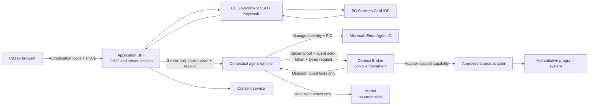
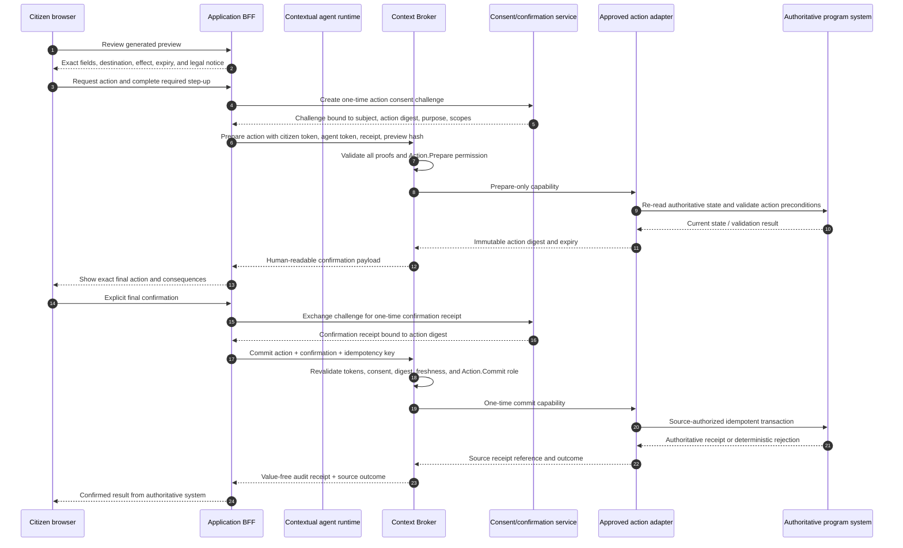

# Production citizen identity and data-access specification

**Status:** Implementation-grade target contract for a future production
citizen-context service. It is not implemented, provisioned, approved for
production data, or evidence that any identity, consent, source-system, or
Microsoft Entra object exists.

**Decision date:** October 28, 2026

**Related specifications:** [Citizen-context ADM validation demo](citizen-context-demo.md)
and [as-built architecture](architecture.md)

The terms **MUST**, **MUST NOT**, **SHOULD**, and **MAY** are normative.

## 1. Decisions and boundaries

The production identity and data-access design has these fixed decisions:

1. A citizen signs in through **BC Government SSO**, which uses Keycloak as an
   identity broker, with the **BC Services Card** identity provider.
2. The relying party uses OpenID Connect Authorization Code with PKCE. The
   browser receives only an opaque application session after the code is
   redeemed by the server.
3. Identity Services approves the BC Services Card privacy zone and the minimum
   claims required by this application. The privacy-zone subject is not a
   universal government identifier.
4. BC Services Card authenticates the citizen. **It is not a warehouse of
   program facts.** Keycloak also does not retain BC Services Card personal
   information for later program-data queries.
5. BC Services Card requires separate authentication and consent for each
   application. This service MUST NOT assume cross-application SSO, shared
   consent, or a token issued to another application.
6. Program facts come only from individually approved source systems through a
   Context Broker and source-specific adapters.
7. The Context Broker authorizes the combination of citizen subject, agent
   actor, purpose, consented scopes, and target adapter. None of those proofs is
   sufficient by itself.
8. A distinct Microsoft Entra Agent ID represents each contextual agent
   instance. The agent identity proves the actor; it does not prove the citizen
   or grant citizen consent.
9. The initial production pattern is a **dual-token** pattern: a BC Government
   SSO token proves the citizen and an Entra Agent ID token proves the agent.
   The Context Broker validates both independently.
10. Direct Entra on-behalf-of (OBO) MUST NOT be assumed from a BC Government
    SSO/Keycloak token. Future OBO requires an approved, compatible user
    assertion audienced to the Agent ID blueprint and approved downstream
    delegated scopes.
11. Synthetic and production adapters implement the same typed boundary but
    use different configuration, identities, data, endpoints, and release
    gates. A synthetic feature flag can never select a production adapter.
12. No identity token, source credential, consent record containing personal
    values, or unrestricted source response is exposed to a model or browser
    JavaScript.

This specification does not authorize transactions. A future action requires a
separately approved action adapter, explicit confirmation, idempotency, and any
program-specific step-up authentication or legal authority.

## 2. Actors, identifiers, and trust boundaries

### 2.1 Actors and systems

| Actor or system | Trust responsibility |
|---|---|
| Citizen browser | Starts sign-in, reviews consent and facts, supplies explicit answers, and confirms any future action; never holds source-system or agent credentials |
| Application BFF | Owns OIDC state, PKCE verifier, server session, CSRF controls, and token handles; does not decide source authorization |
| BC Government SSO / Keycloak | Brokers the approved BC Services Card authentication and issues tokens for the registered application/API |
| BC Services Card IDP | Authenticates the citizen at the approved assurance level and returns only approved privacy-zone attributes |
| Consent service | Issues, versions, narrows, expires, and revokes purpose-bound consent receipts |
| Contextual agent runtime | Requests typed operations; cannot choose arbitrary adapters, fact keys, credentials, or action endpoints |
| Microsoft Entra Agent ID | Issues a distinct actor identity for the contextual agent through its blueprint and child agent identity |
| Context Broker | Policy-enforcement point for subject + actor + purpose + consent + scope + adapter |
| Source adapter | Enforces a source-specific attribute allowlist, authorization method, freshness policy, correction route, and action boundary |
| Authoritative source system | Owns program facts and, where separately approved, program transactions |
| Audit and security monitoring | Receives value-free authorization events, Entra sign-in/audit events, and alerts; never receives raw context values or tokens |



### 2.2 Identifier rules

| Identifier | Rule |
|---|---|
| `zone_subject` | Exact approved BC Services Card privacy-zone subject/identifier claim mapped by CSS. Identity Services MUST confirm whether this is the OIDC `sub` value or another approved claim. It MUST NOT be normalized, guessed, or joined to another zone. |
| `subject_ref` | Application-local pseudonymous reference derived server-side from environment, issuer, privacy zone, relying party, and `zone_subject` using a separately managed keyed function. It is never sent to the browser or another application. |
| `actor_id` | Immutable tenant-qualified Entra Agent ID identifier from validated token claims and the broker allowlist. Display names are not identifiers. |
| `blueprint_id` | Identifies the agent type and governance boundary. It is not the runtime actor. |
| `purpose_id` | Versioned, allowlisted business purpose such as `disability-navigation.v1`; free text is prohibited. |
| `scope_id` | Versioned semantic permission such as `employment.status.read`; broad scopes such as `profile.read-all` are prohibited. |
| `adapter_id` | Versioned source integration identifier mapped by broker policy, not chosen by the browser or model. |
| `consent_receipt_id` | Opaque reference to a server-side receipt. Possession alone grants no access. |
| `request_id` | Unique correlation identifier shared across application, broker, adapter, and audit metadata without carrying personal meaning. |

`subject_ref` remains personal information even though it is pseudonymous. It
MUST be encrypted, access-controlled, retained only for an approved purpose,
and excluded from general analytics.

## 3. BC Government SSO and BC Services Card profile

### 3.1 CSS development and test onboarding

Before runtime implementation, the team MUST complete BC Government SSO
integration onboarding through the Common Hosted Single Sign-on Service (CSS):

1. The product owner or technical owner requests and configures the
   **development** and **test** environments for the integration in CSS.
2. Each environment has its own client identifier, redirect URIs, post-logout
   URIs, home-page URI, issuer metadata, and credential material where required.
3. The integration selects BC Services Card as the IDP and records that
   production approval is still outstanding.
4. Identity Services confirms the intended privacy zone and requested claims.
   Development and test convenience does not pre-approve the production zone,
   production claims, or production data access.
5. Redirect URIs are exact HTTPS values. Wildcards are prohibited; localhost
   is limited to an explicitly registered development client.
6. Development and test use BC Services Card test identities and synthetic or
   non-production source systems only. Production identities, tokens, facts,
   and credentials MUST NOT be copied into lower environments.
7. Tests MUST confirm the documented BC Services Card behavior: each
   application requests its own authentication and consent. An existing session
   in another application is not accepted as proof for this application.

CSS production-environment provisioning occurs only after the privacy, security,
identity, claims, redirect URI, consent, support, and source-system approvals
in section 13 are complete.

### 3.2 OIDC Authorization Code + PKCE

The relying party MUST use this profile:

- Authorization Code flow.
- PKCE with `S256`; `plain` is rejected.
- Cryptographically random, single-use `state`, `nonce`, and PKCE verifier.
- Server-owned authorization transaction with a short expiry.
- Exact issuer discovery and JWKS endpoints for the registered environment.
- Exact redirect URI comparison.
- TLS for every non-local endpoint.
- Authorization code redemption by the BFF, not browser JavaScript.
- Opaque, `Secure`, `HttpOnly`, and appropriately `SameSite` application
  session cookie with rotation at sign-in and privilege changes.
- Server-side access/refresh-token storage or an encrypted token cache. Tokens
  MUST NOT be put in local storage, session storage, URLs, analytics, or logs.
- Refresh tokens only when CSS and the security design approve them; otherwise
  reauthentication is required.
- CSRF protection on every state-changing application and consent endpoint.

The BFF validates the ID token for the login response. The Context Broker
accepts an **access token**, never an ID token, and only when its `aud` is the
registered broker or approved backend API audience. A token issued only to a
different client or resource is rejected.

### 3.3 Claims and token validation

The application requests only claims approved by Identity Services and the
privacy review. Claim names and assurance values are finalized during CSS
onboarding; the application does not infer unavailable claims.

| Claim class | Required handling |
|---|---|
| Signature and issuer | Validate with the environment's allowlisted issuer and current JWKS; reject unknown algorithms, issuers, or keys |
| `aud` and, where applicable, `azp` | Must identify the registered application/API and approved authorized party |
| `sub` | Required and non-empty. Identity Services confirms whether it is the approved privacy-zone identifier or approves an explicit mapping to that identifier. |
| `exp`, `iat`, and `nbf` when present | Validate with a small documented clock-skew allowance; reject expired or implausibly old tokens |
| `nonce` | Required and matched for the ID token in the authorization response |
| Assurance claims such as `acr`, `amr`, or `auth_time` | Consumed only when Identity Services documents and approves their exact semantics for the flow |
| Session/logout claim such as `sid` | Used only if the registered SSO logout profile supports it |
| Approved user attributes | Minimized and mapped explicitly; never accepted merely because a token contains them |

Rules:

- `name`, `email`, or other display claims MUST NOT authorize program access.
- Date of birth, address, PHN, financial identifiers, and similar attributes
  are not requested unless a specific approved purpose cannot operate without
  them.
- An authentication claim does not become an authoritative program fact. A
  source adapter must return program facts with its own provenance and
  freshness.
- BC Services Card role management is not assumed. Application permissions are
  determined by broker policy, consent, and source authorization.
- Unknown claims are ignored and never persisted by default.
- Raw tokens and raw claim sets are not included in application telemetry.

### 3.4 Separate application authentication and consent

For BC Services Card:

- Every application has its own registered client and consent presentation.
- Authentication or consent obtained by another application cannot be imported
  or silently reused.
- The application MUST NOT exchange, iframe, copy, or forward another
  application's session or token.
- Even within the same privacy zone, this application derives its own
  `subject_ref` and maintains its own consent receipt.
- Sign-out clears the local application session and token cache. The user
  interface MUST NOT claim that this signs the citizen out of every BC Services
  Card-enabled application.

## 4. Context Broker authorization model

### 4.1 Authorization tuple

Every broker operation is authorized against this complete tuple:

```text
subject  = validated BC SSO privacy-zone citizen
actor    = validated, allowlisted Entra Agent ID
purpose  = approved versioned service purpose
consent  = active receipt for this subject, app, purpose, and environment
scope    = minimum requested semantic permissions and fact keys
resource = one approved source adapter and operation
```

Authorization is:

```text
ALLOW only when
  citizen_token.valid
  AND agent_token.valid
  AND consent.active
  AND consent.subject == citizen.subject
  AND consent.purpose == request.purpose
  AND requested_scopes ⊆ consent.scopes
  AND requested_fact_keys ⊆ policy.allowed_fact_keys
  AND actor ∈ policy.allowed_actors
  AND adapter ∈ policy.allowed_adapters
  AND adapter.authorizes(subject, actor, purpose, scopes, operation)
  AND environment matches every credential, policy, and endpoint
otherwise DENY
```

The broker MUST fail closed if any token, receipt, policy version, adapter,
freshness rule, revocation check, or audit dependency required by policy is
unavailable.

### 4.2 Required broker inputs

The broker receives or resolves:

1. **Validated BC SSO token**
   - Signature, issuer, audience, time, privacy-zone subject, and approved
     assurance claims are validated.
   - It identifies the citizen subject only.
2. **Validated Entra Agent ID actor token**
   - Signature, tenant, issuer, audience, time, application token type, child
     agent identity, and broker app role are validated.
   - It identifies the agent actor only.
3. **Consent receipt**
   - The broker loads the current server-side receipt and validates subject,
     application, privacy zone, environment, purpose, scopes, categories,
     actor constraints, adapter constraints, version, expiry, and revocation.
4. **Requested scopes and fact keys**
   - Both are typed and allowlisted. The broker rejects undeclared fields and
     never lets the model formulate a generic source query.
5. **Source-system adapter authorization**
   - Broker policy chooses the adapter and operation. The adapter independently
     validates the broker capability and its own source-system grant.

The citizen token is not forwarded to the agent model. The agent token is not
forwarded to the browser. Neither token is forwarded to a source system unless
that exact forwarding is part of a separately approved source protocol.

Both proofs MUST be evaluated in one logical Broker operation. The Broker does
not cache an unmatched citizen-token half or actor-token half for a later caller
to complete.

### 4.3 Consent receipt contract

```ts
interface ProductionConsentReceipt {
  schemaVersion: "1.0";
  id: string;
  receiptVersion: number;
  environment: "development" | "test" | "production";
  relyingPartyId: string;
  privacyZoneId: string;
  subjectRef: string;
  purposeId: string;
  purposeVersion: string;
  scopes: string[];
  categories: string[];
  allowedActorClasses: string[];
  allowedAdapterIds: string[];
  policyVersion: string;
  noticeVersion: string;
  issuedAt: string;
  expiresAt: string;
  status: "active" | "revoked" | "expired" | "superseded";
  revokedAt?: string;
  supersedesReceiptId?: string;
}
```

The receipt contains category and scope names, not fact values. It is stored
server-side. A browser may hold an opaque reference bound to its server session,
but the reference is not a bearer credential and is useless without valid
citizen and actor proofs.

### 4.4 Broker read contract

```ts
interface BrokerReadRequest {
  schemaVersion: "1.0";
  purposeId: string;
  consentReceiptId: string;
  requestedScopes: string[];
  factKeys: string[];
  requestId: string;
}

interface BrokerFact {
  key: string;
  value: unknown;
  category: string;
  sourceSystemId: string;
  sourceRecordVersion?: string;
  verifiedAt: string;
  expiresAt?: string;
  provenance: "authoritative-source" | "citizen-answer";
  sensitivity: "personal" | "protected-a" | "protected-b";
  correctionRouteId: string;
}

interface BrokerReadResult {
  schemaVersion: "1.0";
  requestId: string;
  purposeId: string;
  receiptVersion: number;
  facts: BrokerFact[];
  missingFactKeys: string[];
  staleFactKeys: string[];
  policyVersion: string;
}
```

The public API returns a separate redacted presentation contract. `BrokerFact`
is not serialized generically to the browser or placed wholesale in a prompt.

### 4.5 Authorization order

For each request, the broker MUST:

1. Reject malformed, duplicate, unknown, or oversized fields.
2. Validate the BC SSO access token and derive `subject_ref`.
3. Validate the Entra actor token and resolve the exact child Agent ID.
4. Load the latest consent receipt and check status and version.
5. Match environment, relying party, privacy zone, subject, purpose, and actor.
6. Intersect requested scopes and fact keys with consent and broker policy.
7. Resolve exactly one adapter per requested fact key.
8. Mint or construct an adapter-scoped authorization capability.
9. Let the adapter enforce its own operation and source authorization.
10. Validate the typed response, provenance, source version, and freshness.
11. Minimize the returned fact set to fields actually needed by the rule,
    preview, or confirmed action.
12. Record one value-free decision event with request and policy correlation.

Failures return a stable authorization or availability code. They do not reveal
whether another subject, record, adapter, or fact exists.

## 5. Synthetic-to-production adapter contract

### 5.1 Common interface

```ts
interface AdapterAuthorization {
  schemaVersion: "1.0";
  capabilityId: string;
  environment: "development" | "test" | "production";
  adapterId: string;
  subjectHandle: string;
  actorId: string;
  purposeId: string;
  scopes: string[];
  factKeys: string[];
  consentReceiptId: string;
  consentReceiptVersion: number;
  operation: "read" | "request-correction" | "prepare-action" | "commit-action";
  requestId: string;
  issuedAt: string;
  expiresAt: string;
}

interface CitizenContextAdapter {
  readonly adapterId: string;
  readonly mode: "synthetic" | "production";
  readonly supportedFactKeys: readonly string[];
  readonly supportedOperations: readonly string[];

  readFacts(auth: AdapterAuthorization): Promise<BrokerFact[]>;
  requestCorrection(
    auth: AdapterAuthorization,
    factKey: string,
    proposedValue: unknown
  ): Promise<{ correctionCaseRef: string; status: string }>;
  prepareAction?(
    auth: AdapterAuthorization,
    actionType: string,
    input: unknown
  ): Promise<{ actionDigest: string; expiresAt: string }>;
  commitAction?(
    auth: AdapterAuthorization,
    actionDigest: string,
    confirmationReceiptId: string,
    idempotencyKey: string
  ): Promise<{ sourceReceiptRef: string; status: string }>;
}
```

The wire representation is versioned JSON Schema. Implementations MAY use
different languages, but they MUST preserve the same semantics and negative
authorization behavior.

### 5.2 Synthetic and production implementations

| Concern | Synthetic adapter | Production adapter |
|---|---|---|
| Subject | Fixed, server-owned fictional persona | Privacy-zone `subject_ref` mapped through an approved source lookup |
| Data | Versioned repository fixtures | Minimum fields from one authoritative source |
| Citizen authentication | Server-owned demo session | Valid BC SSO/BC Services Card access token |
| Agent authentication | Optional test actor in the synthetic release | Distinct Entra Agent ID token required |
| Consent | Demo receipt | Production receipt tied to app, zone, subject, purpose, scopes, and adapters |
| Source credential | None | Adapter-owned managed identity, certificate, or other source-approved method |
| Network | Application boundary only | Approved private or authenticated service path |
| Correction | Demo reset or explanatory route | Source-owned correction workflow |
| Action | Never | Absent until a separately approved action adapter is released |

Production configuration MUST reject `mode=synthetic`, fixture persona IDs,
fixture source IDs, and test issuers. Synthetic configuration MUST not contain
production endpoints, source credentials, privacy-zone subjects, or production
adapter registrations.

### 5.3 Adapter capability and source authorization

For a remote adapter, `AdapterAuthorization` is carried in a short-lived,
audience-restricted, signed capability or equivalent mutually authenticated
request. It:

- Is audienced to one adapter.
- Is valid for one operation and one request.
- Expires no later than 60 seconds after issue by default.
- Carries opaque subject and actor references, not raw user or agent tokens.
- Lists exact scopes and fact keys.
- Includes a unique capability ID used for replay detection on correction and
  action operations.
- Is rejected if environment, adapter, purpose, receipt version, or operation
  differs.

An in-process adapter enforces the same checks through a typed policy object.
The adapter then authenticates to its source system using its own approved
identity. A source-system credential is never returned to the broker, agent,
model, BFF, or browser.

The source system or adapter authorization layer MUST grant only the approved
operations for that adapter. Trusting the broker's network location without
checking its identity and capability is insufficient.

## 6. Token and credential boundaries

| Artifact | Issuer and audience | May be held by | Must not reach | Required controls |
|---|---|---|---|---|
| OIDC authorization code | BC SSO; registered redirect URI | Browser redirect and BFF redemption endpoint | Logs, model, source adapter | Single use, short-lived, state and PKCE verification |
| BC SSO ID token | BC SSO; application login client | BFF login handler/token cache | Context API as bearer token, model, adapter, browser storage | Nonce, issuer, audience, signature, time validation |
| BC SSO access token | BC SSO; broker/backend API audience | BFF secure token cache and Context Broker validator | Model, browser JavaScript/storage, source system by default | Signature, issuer, audience, subject, time, approved claim validation |
| Application session cookie | Application BFF | Browser cookie and BFF session store | Agent, adapter, source system | Opaque, secure, HttpOnly, SameSite, rotation, CSRF |
| Consent receipt reference | Consent service/application | Server session, BFF, Broker | Model prompt and source system | Opaque, session-bound, versioned; never sufficient alone |
| Managed identity assertion / Agent ID parent token | Azure/Entra token service; token exchange | Agent token acquisition component | Broker API request body, browser, model, logs | FIC, least privilege, in-memory use, short lifetime |
| Agent ID actor token | Entra; Context Broker audience | Agent runtime and Broker validator | Browser, model, source system by default | Tenant, issuer, audience, child identity, role, time validation |
| Adapter capability | Context Broker; one adapter audience | Broker and named adapter | Browser, model, other adapters | One operation, short expiry, replay controls |
| Source credential/token | Source-approved issuer; source API | Named adapter only | Broker response, application, agent, model, browser | Managed identity/certificate where possible, source scopes, rotation |
| Typed source facts | Source adapter; Broker contract | Adapter, Broker, bounded rule/preview service | Search, analytics, unrestricted prompts, unrelated flows | Minimization, provenance, freshness, encryption, consent checks |

Only token fingerprints, issuer/audience identifiers, expiry, outcome, and
correlation IDs MAY be logged. Full tokens, authorization codes, PKCE values,
cookies, assertions, and source credentials are prohibited log fields.

## 7. Microsoft Entra Agent ID target

### 7.1 Object model and ownership

Each environment uses a separate Agent ID object set:

```text
Agent Identity Blueprint application
  └── Blueprint Principal service principal
        └── Distinct child Agent Identity service principal per agent instance
```

Requirements:

- One blueprint exists for one contextual agent type in one environment.
- The blueprint principal is created explicitly and validated; creation of the
  blueprint alone is not treated as sufficient.
- Every independently governed agent instance has a distinct child Agent ID.
  A transient compute replica is not a new business agent instance, but
  unrelated agents, applications, purposes, and environments never share an
  identity.
- The blueprint has a named business sponsor and technical owner. Each child
  identity has an accountable sponsor and operational owner.
- Description, environment, application, purpose class, support contact, data
  sensitivity, and decommission date are recorded as governed metadata.
- Credentials belong to the blueprint, not to child Agent IDs.
- Broker and source permissions are granted to the child Agent ID or inherited
  only through an explicitly reviewed Agent ID permission design. They are not
  broadly granted to an unrelated service principal.

### 7.2 Production credential pattern

Production MUST use an Azure managed identity plus a federated identity
credential (FIC) on the Agent ID blueprint, or a later secretless Microsoft
mechanism approved by the tenant administrators.

- No client secret is created, stored, deployed, or used for a production Agent
  ID blueprint.
- The managed identity is assigned only to the contextual runtime that needs it.
- The FIC issuer, subject, audience, tenant, environment, and blueprint are
  exact and environment-specific.
- The Agent ID token acquisition component uses Microsoft's supported Agent ID
  SDK/library where available and keeps intermediate token-exchange artifacts
  in memory.
- Token acquisition selects the intended child identity through the supported
  Agent ID `fmi_path` exchange; it does not authenticate to the Broker as the
  blueprint principal.
- The final actor token is audienced to the Context Broker and identifies the
  child Agent ID.
- Local development MAY use a short-lived development credential only in a
  non-production tenant when managed identity is unavailable. It is never
  promoted, copied, or accepted in production.

### 7.3 Per-agent permissions

The Context Broker defines narrow application roles or equivalent permissions,
for example:

- `Context.Read`
- `Context.Correction.Request`
- `Action.Prepare`
- `Action.Commit.<approved-action>`

Each child Agent ID receives only the roles needed for its approved purpose.
`Action.Commit` is absent until the matching action adapter and governance gate
are approved. Broad directory permissions, generic source access, and
Microsoft Graph permissions are not granted unless a separately documented
requirement proves they are necessary.

Permissions are reviewed at onboarding, release, material purpose change, and a
scheduled access review. Removing an unused permission is part of the release,
not deferred cleanup.

### 7.4 Conditional Access and risk controls

Tenant administrators MUST create agent-specific Conditional Access policy
rather than relying on user MFA policies that a workload identity cannot
satisfy. The production design SHOULD:

- Select agent identities through supported identity filters or governed
  attributes such as environment and data sensitivity.
- Block non-production agents from production broker audiences.
- Restrict unexpected locations or networks where supported.
- Block high-risk agent identities using supported risk signals.
- Start in report-only mode, test expected and denied paths, and then enforce.
- Alert on policy exclusions, unexpected grants, and repeated token failures.

The final policy depends on tenant capabilities and must be approved by Entra
administrators. This document does not claim that such a policy exists.

### 7.5 Kill switches and lifecycle

Operators need independent kill switches:

1. Disable the contextual application feature while preserving anonymous mode.
2. Deny one child Agent ID at the Context Broker.
3. Remove one child Agent ID's broker permission.
4. Disable one child Agent ID.
5. Disable the blueprint to block all child identities of that agent type.
6. Remove or disable the managed identity/FIC trust.
7. Disable one source adapter or one operation.
8. Revoke active consent receipts for an affected purpose.

The runbook defines authority, ordering, expected propagation, verification,
rollback, and citizen communications for each switch. Kill-switch drills occur
before production and at an approved recurring interval.

### 7.6 Audit and sign-in logs

Monitoring MUST correlate:

- Entra agent sign-in logs for token acquisition result, resource, credential
  type, tenant, IP/network context, and child identity.
- Entra audit logs for blueprint, principal, child identity, sponsor/owner,
  credential, permission, Conditional Access, and disable/enable changes.
- Context Broker authorization decisions.
- Adapter access and source transaction receipts.
- Consent issue, narrowing, expiry, and revocation events.

Alerts cover unexpected resources, unusual token volume, unfamiliar network
origin, repeated failures, new credentials, permission expansion, owner or
sponsor removal, Conditional Access bypass, and disabled kill switches.

Logs can represent Agent ID operations as application or user-management events
depending on the Microsoft log. Correlation uses immutable object IDs and
request IDs, not display names or an assumption that every event has a special
"agent" label.

## 8. Dual-token initial pattern and future OBO

### 8.1 Initial production pattern

The initial pattern is **not** token exchange between BC Government SSO and
Microsoft Entra:

1. The citizen authenticates through BC Government SSO/BC Services Card.
2. The Context Broker validates the BC SSO access token and derives the
   application-local `subject_ref`.
3. The contextual runtime obtains an Entra Agent ID actor token for the Broker.
4. The Broker validates the actor token independently.
5. The Broker validates a current consent receipt and the requested purpose,
   scopes, fact keys, adapter, and operation.
6. The adapter uses its source-approved application, managed identity,
   certificate, delegated, or other authorization pattern.

The two identity tokens are jointly required but are not interchangeable. The
agent token cannot impersonate the citizen. The citizen token cannot identify
or authorize the agent. The consent receipt cannot replace either token.

If a source system requires user delegation, that source receives a separately
approved delegation design. The Broker MUST NOT relabel an application-only
source call as OBO.

### 8.2 Why direct Entra OBO cannot be assumed

A BC Government SSO token is issued by the approved Keycloak realm to the
registered BC relying party/backend audience. Microsoft Entra Agent ID OBO
requires a user assertion that Microsoft Entra accepts and whose audience is
the Agent ID blueprint. Therefore:

- A Keycloak token cannot simply be placed in the Entra OBO `assertion` field.
- A token audienced to the Context Broker, Microsoft Graph, or another API is
  not a blueprint-audienced assertion.
- Possession of an Agent ID blueprint, managed identity, or delegated
  permission does not make the BC SSO token compatible.
- A custom token translator is not approved by this specification.

### 8.3 Conditions for future true OBO

True Entra Agent ID OBO MAY be considered only when all of these conditions are
met:

1. An approved client or federation/token-exchange design produces a user
   assertion that Microsoft Entra can validate.
2. The assertion is explicitly audienced to the Agent ID blueprint/API and
   carries the required delegated scope. A token for another audience is
   rejected.
3. Identity Services, Entra tenant administrators, privacy, security, and the
   downstream program owner approve the issuer, audience, subject mapping,
   token exchange, and revocation semantics.
4. The blueprint is configured as an API for the approved user-delegation scope
   and the calling client is approved or preauthorized as required.
5. Each child Agent ID has only the downstream delegated scopes required for
   its purpose, with valid administrator/user consent as the service requires.
6. The downstream resource supports those delegated scopes for Agent ID and
   does not require an incompatible subject or assurance model.
7. The mapping preserves privacy-zone isolation and does not create a reusable
   cross-zone identifier.
8. A supported Microsoft Agent ID SDK/library implements the flow, and negative
   tests cover issuer, audience, child identity, scope, consent, and revocation.
9. Tokens remain outside prompts, tool bodies, browser storage, and logs.
10. The OBO path has its own kill switch and can fall back to a safe,
    non-transactional handoff.

Until every condition is evidenced, production remains on the dual-token
pattern.

## 9. Sequence diagrams

### 9.1 Sign-in and context read

```mermaid
sequenceDiagram
    autonumber
    participant C as Citizen browser
    participant A as Application BFF
    participant S as BC Government SSO / Keycloak
    participant I as BC Services Card IDP
    participant K as Consent service
    participant R as Contextual agent runtime
    participant E as Microsoft Entra Agent ID
    participant B as Context Broker
    participant D as Approved source adapter
    participant P as Authoritative source

    C->>A: Start contextual flow
    A->>A: Create state, nonce, PKCE verifier
    A->>S: OIDC authorize + code challenge + app redirect
    S->>I: App-specific authentication and consent
    I-->>S: Approved privacy-zone identity claims
    S-->>C: Authorization code to exact redirect
    C->>A: Authorization code + state
    A->>S: Redeem code + PKCE verifier
    S-->>A: ID token + broker-audienced access token
    A->>A: Validate login response; create opaque server session
    A-->>C: Purpose and minimum category consent notice
    C->>A: Grant selected scopes
    A->>K: Issue receipt for subject, app, zone, purpose, scopes
    K-->>A: Opaque receipt reference
    A->>R: Server-only citizen token + receipt + typed operation
    R->>E: Managed identity + FIC Agent ID token acquisition
    E-->>R: Child Agent ID actor token for Context Broker
    R->>B: Citizen token + actor token + receipt + purpose + scopes/fact keys
    B->>B: Validate subject + actor + consent + purpose + scope + adapter
    B->>D: One-operation adapter capability
    D->>P: Source-approved authenticated minimum-field read
    P-->>D: Source facts + version/freshness
    D-->>B: Typed minimized facts
    B-->>R: Authorized facts only
    R-->>A: Validated explanation/rule/preview artifact
    A-->>C: Context used, provenance, freshness, and correction route
```

No token or credential in this sequence is supplied to the model. The model
receives only the minimum typed values selected for the current explanation.

### 9.2 Future separately approved action



If facts changed, consent was revoked, confirmation expired, step-up failed, or
the action digest differs, the commit fails closed and returns to review. A
model tool call can prepare a preview but cannot manufacture the citizen's
confirmation receipt.

## 10. Consent, correction, retention, and minimization

### 10.1 Consent lifecycle

Consent has these states and transitions:

```text
proposed -> active -> narrowed -> superseded
                  \-> revoked
                  \-> expired
```

- **Proposed:** The citizen sees purpose, categories, fact types, source
  systems, optional scopes, retention, and consequences of declining.
- **Active:** The server issues a versioned receipt for selected minimum scopes.
- **Narrowed:** Removing a category creates a new receipt version and
  immediately invalidates the superseded version.
- **Renewed:** Expiry requires a new affirmative decision. Continued use or
  page activity is not consent.
- **Revoked:** Revocation is available in the active experience and through an
  account/privacy route approved for the service.
- **Expired:** Broker and adapter access ends automatically.
- **Purpose change:** A new purpose requires a new notice and receipt; purpose
  cannot be expanded in place.

Revocation MUST:

1. Mark the receipt revoked in the authoritative consent store.
2. Reject subsequent broker calls immediately.
3. Invalidate unused adapter capabilities and action confirmations.
4. Cancel or fail any operation that has not crossed an authoritative
   transaction commit boundary.
5. Remove or mark stale dependent previews, recommendations, and caches.
6. Record a value-free revocation event.
7. Explain any authoritative transaction that had already completed and route
   the citizen to the program's correction or withdrawal process.

### 10.2 Correction

The Context Broker never silently overwrites an authoritative source fact.

- The context drawer identifies source, verification time, mutability, and
  correction route.
- A correction request is separately scoped and consented.
- The adapter sends the proposed correction to the source-owned process or
  returns instructions for that process.
- While disputed, the broker marks the fact `contested` or excludes it from
  high-impact rules and actions according to program policy.
- Citizen answers can be corrected in the active application session, but they
  remain labelled `citizen-answer` and do not become government records.
- Correction case details remain in the authoritative source/case system, not
  in a reusable central citizen profile.

### 10.3 Retention

| Data class | Retention rule |
|---|---|
| Authorization code, state, nonce, PKCE verifier | Single authorization transaction only; deleted after success, failure, or short transaction expiry |
| ID/access/refresh tokens | Encrypted server-side cache only; never beyond token expiry or session termination; revoked/cleared on sign-out where supported |
| Agent intermediate and actor tokens | Memory or approved secure cache only; no longer than token lifetime; never written to application logs |
| Consent receipt | Active through the approved purpose window; then retained or deleted according to the PIA, records schedule, dispute needs, and legal authority |
| Adapter capability | One request/operation; default maximum 60 seconds |
| Raw context facts | No cross-session cache by default; retained only for the active operation/session and shorter than consent and source freshness limits |
| Preview/action package | Active review window only unless the program has an approved draft-record authority and retention schedule |
| Correction case | Retained by the authoritative correction process; broker stores only an opaque case reference when approved |
| Audit/security metadata | Value-free fields retained for the approved security, records, and compliance period |
| Prompts, transcripts, analytics, Search | No raw citizen context, tokens, source payloads, or action payloads |

Exact production durations are release configuration and approval items. A
service MUST NOT launch with unspecified or inherited default retention.

### 10.4 Privacy-zone isolation

- The privacy zone is selected with Identity Services for the application's
  approved business context.
- `zone_subject` is accepted only from the registered issuer and zone.
- `subject_ref` keys, stores, and indexes are separated by application,
  environment, and privacy zone.
- No matching by name, email, date of birth, address, PHN, or other attributes
  is used to correlate people across privacy zones.
- No cross-zone lookup API or global citizen table exists.
- A program need to reconcile identities across zones requires a separate legal,
  privacy, identity, and technical design. It is not a Broker feature.
- Logs and analytics cannot be joined across zones using `subject_ref`.

### 10.5 Data minimization

The broker works from fact-level allowlists:

- Ask whether a rule can operate on a boolean, range, category, or verified
  status instead of a raw source value.
- Read only fact keys required by the current rule, preview field, or confirmed
  action.
- Return `missing` rather than broadening the query.
- Do not prefetch every consented field.
- Do not create a reusable cross-program profile.
- Do not send identifiers or facts to Search, Web IQ, general analytics, or a
  model unless the exact minimized value is required for the current approved
  response.
- Redact or transform values before presentation when the full value is not
  needed.

## 11. Threat model

| Threat | Preventive controls | Detection and required test |
|---|---|---|
| Confused deputy | Broker authorizes subject + actor + purpose + receipt + scope + adapter + operation; adapter checks its own capability and source grant | Attempt to reuse a valid receipt for another purpose, actor, adapter, or operation; all must fail |
| Token replay | Authorization Code + PKCE, short token lifetimes, TLS, no token logging, session rotation, one-operation adapter capability, replay cache for correction/action capability IDs | Replay authorization code, action confirmation, capability, and expired actor/user tokens; alert on repeated `jti`/capability use |
| Cross-privacy-zone correlation | Zone/app/environment-specific `subject_ref`, separate keys and indexes, no global subject table, no attribute matching | Supply a valid subject from another zone and search for same-person attributes; no join or existence signal is returned |
| Overbroad scopes | Versioned semantic scopes, fact-key allowlists, per-agent Broker roles, adapter-level policy, no generic query endpoint | Ask for undeclared facts, wildcard scopes, all-record queries, or a scope consented for another adapter; deny and log metadata |
| Prompt injection | Treat facts, source text, citizen text, and model output as untrusted data; schema validation; no credentials in prompts; deterministic policy and action gates | Put tool-like instructions in a fact/source value and verify they remain inert data |
| Context exfiltration | Minimize before model use, output schema and redaction, no raw tool bodies, no context in Search/analytics/logs, egress allowlists, browser presentation contract | Ask model to reveal hidden context, identifiers, tokens, another subject, or raw source payload; verify no disclosure and scan telemetry |
| Stale facts | Source `verifiedAt`/version/expiry, per-fact freshness policy, visible freshness, contested state, authoritative re-read before action commit | Advance source version or expire a fact between preview and commit; commit must stop and require review |
| Actor impersonation | Distinct child Agent ID, MI+FIC, no production secrets, audience/tenant/child-ID/role checks, per-agent permissions and CA | Use blueprint principal, managed identity token, sibling Agent ID, dev Agent ID, or token for another audience; all must fail |
| Consent replay or resurrection | Server-side receipt status/version, subject/session binding, revocation check per call, superseded version denylist | Reuse a narrowed, revoked, expired, or prior-version receipt; dependent artifacts become unavailable |
| Cross-subject data leak | Server-derived subject only, no browser subject input, adapter subject binding, per-request isolation | Modify subject references, race two sessions, and switch persona/account during a run |
| Source adapter compromise | One adapter audience, least-privilege source identity, network controls, response schema, kill switch, outbound allowlist | Attempt lateral access to another adapter/source and inject untyped extra fields |
| Action tampering | Immutable preview/action digest, one-time confirmation, step-up, idempotency, authoritative re-read, separate prepare/commit permissions | Change one field after confirmation, replay idempotency key, or let model call commit without confirmation; no duplicate or altered action |

Threat-model evidence is required for each production adapter and action, not
only for the shared Broker.

## 12. Environment separation

| Boundary | Local/synthetic | Development | Test | Production |
|---|---|---|---|---|
| Citizen identity | No real sign-in | CSS development client and BC Services Card test identities | CSS test client and BC Services Card test identities | Separately approved CSS production client |
| Privacy zone | Fixture label only | Approved non-production configuration | Production-candidate zone configuration without production data | Identity Services-approved production zone |
| Agent ID | Local test actor or non-prod Agent ID | Development blueprint/principal/child identities | Test blueprint/principal/child identities | Production blueprint/principal/child identities |
| Agent credential | Local non-prod method | Non-prod MI/FIC preferred | MI/FIC | MI/FIC; no Agent ID secret |
| Context data | Fixed fictional fixtures | Synthetic/stub data | Approved non-production data | Minimum approved program facts |
| Adapters | Synthetic only | Development endpoints | Test endpoints | Production endpoints |
| Keys and token audiences | Local only | Development-specific | Test-specific | Production-specific |
| Logs | Developer-safe synthetic metadata | Non-prod log destination | Production-like controls with test data | Approved protected security/audit destinations |

Mandatory controls:

- Separate CSS clients, issuers/realms as applicable, redirect URIs, cookies,
  encryption keys, token audiences, consent stores, Agent ID objects, managed
  identities, broker registrations, adapters, source credentials, and logs.
- Environment is embedded in receipts, capabilities, policies, and resource
  names and is checked on every request.
- No production token, subject, source record, consent receipt, action payload,
  credential, or log export enters development or test.
- Production denies test issuers, test signing keys, localhost redirects,
  synthetic persona IDs, fixture source IDs, and non-production Agent IDs.
- Promotion moves reviewed configuration definitions, not live credentials,
  identities, receipts, or citizen data.

## 13. Governance and onboarding checklist

### 13.1 BC identity and relying party

- [ ] Product owner, technical owner, privacy lead, security lead, support owner,
      and records owner are named.
- [ ] CSS development and test environments/clients are configured with exact
      redirect, logout, and home-page URIs.
- [ ] Authorization Code + PKCE `S256` is tested, including negative state,
      nonce, verifier, issuer, audience, and redirect cases.
- [ ] BC Services Card test IDP is enabled in development/test.
- [ ] Identity Services approves the production privacy zone.
- [ ] The minimum production claim/scopes list and assurance interpretation are
      approved and documented.
- [ ] Per-application authentication and consent copy is tested; no
      cross-application SSO claim appears in UX or support material.
- [ ] CSS production integration and support/escalation route are approved.

### 13.2 Consent, privacy, legal, and records

- [ ] PIA and information-sharing authority cover each purpose, category,
      adapter, fact key, correction route, and recipient.
- [ ] Consent notice, receipt schema, expiry, renewal, narrowing, revocation,
      and account/privacy route are approved.
- [ ] Privacy-zone isolation and prohibition on cross-zone correlation are
      explicitly reviewed.
- [ ] Data-minimization and no-central-profile decisions are accepted by each
      program owner.
- [ ] Exact token, fact, preview, receipt, audit, and security-log retention
      schedules are approved.
- [ ] Citizen access and correction processes identify the authoritative owner.
- [ ] Plain-language and accessibility reviews are complete.

### 13.3 Context Broker and source adapters

- [ ] Broker API audiences exist separately for each environment.
- [ ] User and agent token validators pin approved tenant/issuer/audience,
      algorithms, time rules, and immutable identifiers.
- [ ] Purpose, scope, fact-key, actor, adapter, and operation policy is
      versioned and peer-reviewed.
- [ ] Each adapter has a data steward, legal authority, technical owner,
      attribute allowlist, freshness policy, correction route, support target,
      incident contact, and kill switch.
- [ ] Source-system authorization is least privilege and independently enforced.
- [ ] Synthetic and production adapters pass the same contract tests and the
      production environment rejects synthetic configuration.
- [ ] No generic government-record query endpoint exists.
- [ ] No raw context appears in Search, Web IQ, prompts, tool-body logs,
      transcripts, URLs, browser storage, or analytics.

### 13.4 Microsoft Entra Agent ID

- [ ] Separate blueprint, blueprint principal, and child Agent IDs exist for
      each environment and approved agent type.
- [ ] Blueprint and each child identity have a current sponsor and owner.
- [ ] Production runtime uses managed identity + FIC; no Agent ID client secret
      exists in production.
- [ ] Each child Agent ID has only approved Broker roles and downstream
      permissions.
- [ ] Agent-specific Conditional Access/risk policy is tested in report-only and
      then enforced.
- [ ] Sign-in and audit logs are exported to approved monitoring with immutable
      object-ID correlation.
- [ ] Access review, sponsor review, credential/FIC review, and decommission
      schedules are active.
- [ ] Per-agent and blueprint kill switches are tested.

### 13.5 Operational release

- [ ] Security Threat and Risk Assessment includes the threats in section 11
      and adapter-specific abuse cases.
- [ ] Revocation, stale-fact, source outage, token outage, log outage, and
      partial-transaction behavior fail safely.
- [ ] Incident response covers token theft, agent compromise, source breach,
      erroneous facts, unauthorized correlation, and completed transactions.
- [ ] Support can explain that BC Services Card authenticates identity but does
      not store or supply all government program facts.
- [ ] Monitoring uses value-free events and alerts without reconstructing a
      citizen profile.
- [ ] Anonymous mode remains available and can operate when contextual mode is
      disabled.
- [ ] A production readiness review records every external approval and evidence
      link.

### 13.6 Additional gate for actions

- [ ] Program owner and legal authority approve the exact transaction.
- [ ] Action-specific scopes, step-up, confirmation text, source permissions,
      idempotency, expiry, cancellation, correction, and withdrawal are defined.
- [ ] `Action.Prepare` and `Action.Commit` are separate permissions.
- [ ] Authoritative state is re-read before commit.
- [ ] The action adapter returns a source-owned receipt and deterministic error
      states.
- [ ] Human confirmation cannot be generated or replayed by the agent/model.
- [ ] The action kill switch is tested independently from context reads.

## 14. Required verification

At minimum, implementation evidence MUST include automated tests proving:

- Correct OIDC code + PKCE sign-in and rejection of bad state, nonce, verifier,
  issuer, audience, signature, redirect URI, time, and token type.
- An ID token cannot call the Context Broker.
- A token from another application, privacy zone, or environment is rejected.
- BC Services Card authentication/consent is requested separately for this app.
- The broker denies a missing or invalid citizen token, agent token, receipt,
  purpose, scope, fact key, adapter, or operation.
- The blueprint principal, managed identity, sibling child Agent ID, and
  non-production child Agent ID cannot impersonate the approved agent.
- Revocation and narrowing invalidate old receipt versions and dependent
  artifacts immediately.
- Cross-subject and cross-zone lookups do not reveal existence or data.
- Prompt injection remains inert and context-exfiltration prompts disclose
  nothing outside the presentation contract.
- Stale or contested facts cannot support a governed action.
- Adapter capability and action confirmation replay are rejected.
- Token, credential, raw claim, raw context, and action payload scans find
  nothing in logs, traces, analytics, Search, or browser storage.
- Per-agent, blueprint, adapter, consent-purpose, and contextual-mode kill
  switches deny new access.
- A BC SSO/Keycloak token is never sent directly to Entra OBO in the initial
  implementation.

## 15. External approvals still required

This specification intentionally leaves these external decisions unresolved:

| Approval or decision | External owner | Status |
|---|---|---|
| CSS development/test registrations and final protocol settings | BC Government SSO/CSS service | Required; not created by this specification |
| BC Services Card production onboarding | Identity Services / BC Services Card team | Required |
| Production privacy zone and subject semantics | Identity Services with privacy/program owners | Required |
| Approved claim list and assurance interpretation | Identity Services, privacy, security, and program owners | Required |
| Production CSS client, redirect/logout URIs, token lifetimes, and credential mode | BC Government SSO/CSS service and security | Required |
| PIA, information-sharing authority, consent language, and records schedule | Privacy, legal, records, and program data stewards | Required |
| Source fact allowlist, lookup semantics, freshness, correction, and source authorization | Each source-system owner/data steward | Required per adapter |
| Entra Agent ID tenant roles, object creation, MI/FIC trust, app roles, and Conditional Access | Microsoft Entra tenant administrators | Required |
| Agent sign-in/audit export and retention | Security operations, privacy, and records | Required |
| Compatible BC-to-Entra user assertion or token-exchange design for true OBO | Identity Services, Entra administrators, Microsoft-supported design authority, privacy, and security | Not approved; dual-token pattern remains mandatory |
| Downstream delegated scopes for any future OBO | Each downstream resource owner and Entra administrators | Not approved |
| Any transactional action, step-up, delegated authority, and source commit API | Program owner, legal, privacy, security, and source owner | Not approved |

No production provisioning, runtime change, or real-data pilot should begin
until the relevant approvals are recorded against the checklist.

## 16. References

Repository specifications:

- [Citizen-context ADM validation demo](citizen-context-demo.md)
- [As-built architecture](architecture.md)
- [Pilot specification](pilot-specification.md)
- [Implementation contract](implementation-contract.md)

Official external references:

- BC Government SSO documentation:
  <https://bcgov.github.io/sso-docs/>
- BC Services Card privacy zones and integration:
  <https://bcgov.github.io/sso-docs/advanced/bc-services-card>
- BC Services Card common component:
  <https://digital.gov.bc.ca/bcgov-common-components/bc-services-card/>
- Microsoft Entra Agent ID OBO:
  <https://learn.microsoft.com/entra/agent-id/agent-on-behalf-of-oauth-flow>
- Microsoft Entra Agent ID best practices:
  <https://learn.microsoft.com/entra/agent-id/best-practices-agent-id>

References describe platform capabilities; they do not supply the program,
privacy, security, source-system, or production approvals listed above.
