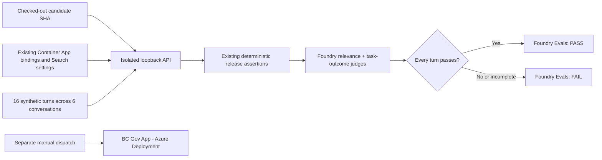

# Foundry Evals for the BC Gov App

GitHub asks prewritten questions, your app answers using its existing Foundry AI,
and an AI judge grades the answers.

## Who asks, answers, and grades

| Role | Who does it | What they do |
|---|---|---|
| Asks | The test runner in GitHub Actions | Sends the fixed messages below to the candidate app's API |
| Answers | The BC Gov App | Uses its existing Foundry agents and application logic to reply |
| Grades | The selected Foundry judge deployment | Scores each captured reply for relevance and the expected task outcome |

The app keeps using the model configured in its existing Foundry agents. The
judge is selected separately through `FOUNDRY_EVALUATION_MODEL_DEPLOYMENT`.
Choosing a judge does not replace the app's model. These two roles can use the
same approved deployment or different deployments.

Some app replies, including parts of its dialogue and preparation guidance, are
handled in code without generating a new model answer. The judge assesses the
reply the app returned. It does not choose the test questions or rewrite the
answers.

## The 16 messages

These are synthetic public questions and replies, grouped into six conversations.
Within each conversation, the runner sends the messages in the order shown. Short
replies such as "Yes" depend on the preceding exchange.

The source of truth is
[`data/evaluations/foundry-release-policy.json`](../data/evaluations/foundry-release-policy.json),
which also records the expected behaviour for every turn. The wording below is
copied exactly, including capitalization and spelling. Resident conversations and
production traces are excluded.

### B.C. licence renewal (`renewal`)

Checks the issuer clarification, short replies, task progress, city selection,
and official handoff.

1. "please help me renew my drivers license"
2. "Yes"
3. "are you helping?"
4. "I have my ID"
5. "Vancouver"
6. "What else should I bring?"

### Adult guardianship (`guardianship`)

Checks that the app keeps the correct subject and gives a specific official
next step.

1. "I need to apply for guardianship"
2. "An adult"

### Disability assistance (`disability`)

Checks programme clarification without collecting medical history.

1. "I need to apply for disability"
2. "Provincial disability assistance"

### Job loss (`job-loss`)

Checks the preference for employment help and the WorkBC handoff.

1. "I just lost my job, what do I do?"
2. "Finding work"

### Non-B.C. licence (`non-bc`)

Checks that the app retains a negative answer without looping back to B.C.
renewal.

1. "help me renew my drivers license"
2. "Issued somewhere else"
3. "Renew with the original issuer"

### Health Connect Registry (`health`)

Checks that the app returns a sourced health answer with citations.

1. "What is the Health Connect Registry?"

## Worked example: licence renewal, then "Yes"

**Illustrative examples only. These sample app replies are not captured output
or actual evaluation results.**

### First turn: clarify the issuer

GitHub sends:

> please help me renew my drivers license

The policy expects the app to understand licence renewal and ask whether the
licence was issued in B.C., without inventing personal facts or claiming to have
renewed it.

An illustrative reply that meets that expectation:

> Was your licence issued in B.C.?

The judge checks whether the reply addresses the renewal request and asks the
necessary issuer question. A clarification can be a successful answer at this
point; the app is not expected to complete a renewal.

### Follow-up: use the answer and move forward

GitHub sends:

> Yes

Here, "Yes" answers the issuer question. The expected behaviour is to start
identification preparation, include the specific ICBC accepted-ID link, and stop
asking where the licence was issued.

Passing example, illustrating the intended reply:

> For your B.C. licence renewal, start by reviewing
> [ICBC's accepted identification guidance](https://www.icbc.com/driver-licensing/visit-dl-office/Accepted-ID).

The judge checks that the reply uses "Yes" in context and moves the user to the
expected next step. The code checks also verify that the app recorded the
licence-renewal journey, cleared the pending question, selected the
identification-preparation step, and returned the required official link.
Sample text alone cannot establish that the app's state is correct.

Failing example:

> Was your licence issued in B.C.?

This repeats a question the user already answered and omits the required
identification handoff. The missing ICBC link alone would fail a code-based
check. In a real run, that stops collection before Foundry judging begins, so
there would be no judge scores for this failed run.

## How an answer is graded

Each answer has two scores:

| Score | What the judge checks |
|---|---|
| Relevance (`builtin.relevance`) | Does this reply address the user's current request in the context of the conversation? |
| Task outcome (`task_outcome`) | Does the latest reply meet this turn's expected behaviour and respect its boundaries? |

Both checks use the selected judge deployment. The judge receives preceding
dialogue so it can interpret follow-ups such as "Yes"; the task-outcome check also
receives the policy's expected behaviour for that turn. With 16 replies and two
checks per reply, a complete run has 32 planned judge scores.

The custom task-outcome rubric uses this scale:

| Score | Meaning |
|---|---|
| 1 | Contradicts the expected behaviour or crosses a safety boundary |
| 2 | Misses the user's task |
| 3 | Is partly useful but misses an essential requirement |
| 4 | Meets every essential requirement with a useful next step or necessary clarification |
| 5 | Meets those requirements clearly and concisely |

This is the app's custom task-outcome scale. It does not describe the internal
rubric of Foundry's built-in relevance evaluator.

All code-based release assertions and synthetic-session cleanup must pass before
the responses are sent to the judges. Then every reply needs a relevance score
of at least 4/5, a task-outcome score of at least 4/5, and a passing result from
both evaluators. All expected answers and scores must be present and valid.
One failed turn fails the evaluation; an average cannot hide it.

The judge grades meaning, so different helpful wording can pass. Code checks
still require the correct official link destinations and conversation state.
Useful preparation, a necessary clarification, or an honest official handoff
can all meet the expected outcome. Pretending to complete a government
transaction does not.

## What the results look like

**Illustrative score table only. These numbers are invented to explain the
report, not taken from a run or predicted for the sample replies above. This is
an excerpt, not a complete 16-turn report.**

| Turn | Relevance | Task outcome | Result |
|---|---:|---:|---|
| `renewal:1` | 5 | 4 | Pass |
| `renewal:2` | 4 | 5 | Pass |
| `health:1` | 3 | 4 | Fail |

The identifier `renewal:2` means the second turn in the renewal conversation. In
this hypothetical report, the health turn fails because relevance is below 4.
The other high scores cannot make the evaluation pass. This score example is
separate from the earlier code-check failure, which would produce no judge
scores.

### Where to inspect a real run

| Location | What you can inspect |
|---|---|
| GitHub Actions job summary | Per-turn scores, pass/fail status, the code version (candidate SHA), and a Foundry report link when available |
| The `foundry-evaluation` GitHub artifact | Metadata and scores, without conversation text or judge explanations |
| The run in Foundry's Evaluations area | The submitted synthetic questions and app answers, plus detailed judge explanations |

If a run fails before cloud submission, GitHub can show the failure without a
Foundry report or judge scores. Missing scores never count as a pass.

A passing evaluation shows that this suite's relevance and behaviour checks
passed. It is not a factual or legal-accuracy certification, and it does not
approve a release. BC Gov App deployment remains a separate workflow.

## How the workflow runs

Run **BC Gov App - Foundry Evals (Relevance & Task Outcomes)** from GitHub Actions
to check the candidate application's responses. The
[Foundry Evals workflow](../.github/workflows/foundry-evals.yml) collects synthetic
conversations, scores them in Foundry, and publishes the results.

[BC Gov App - Azure Deployment](../.github/workflows/azure-pilot.yml) handles
provisioning, image deployment, and deployment verification separately. Neither
workflow calls or waits for the other. A failed evaluation fails its own run; it
does not automatically block or trigger deployment. Both workflows are manual
and neither runs automatically on a PR.

An administrator must configure the approved judge deployment, permissions, and
storage approval before running a live evaluation.

Foundry scores responses from the candidate application. Running requests through
the API includes its retrieval, source validation, conversation state, consent,
function execution, and output validation. A direct call to the managed Foundry
prompt agent would bypass those behaviours.



The runner combines this checkout's API code and catalogue with settings from the
existing API Container App. It reads only an allowlist of non-secret settings:
the pinned general, planner, and seven pathway bindings, plus the Search index
and embedding settings. A dirty checkout, wrong SHA, unsupported conversation
profile, or changed configuration fails the evaluation.

The tests use the ordinary version-5 conversation path in an isolated API.
Authentication uses Azure CLI through the workflow's OIDC login, and session
controls stay within the test process. Production authentication, Redis, counters,
telemetry, agent definitions, and source content remain unchanged. Optional
research, synthetic-persona mode, version 6, and the local-only evidence profile
stay disabled in this process.

### Detailed result checks

| Layer | Required result |
|---|---|
| Application | Every existing release assertion passes, and every synthetic session is cleaned up |
| Foundry `builtin.relevance` | Every turn scores at least 4/5 and the evaluator passes |
| Foundry custom `task_outcome` score grader | Every turn scores at least 4/5 and the grader passes |
| Completeness | Exactly the expected rows and both metrics, matching the submitted responses and run IDs |
| Execution | The run completes with no missing, duplicate, nonfinite, failed, errored, or cancelled result |

The evaluation runner applies the checked-in threshold even when Foundry's
built-in default pass label uses a lower one.

Treat the initial 4/5 thresholds as release policy, not calibrated accuracy
estimates. Run Foundry Evals to check for false positives before using its results
in a release decision. Rubric and threshold changes need source review; workflow
inputs cannot change them. Record a new baseline whenever the policy hash changes.

## Set up Foundry and GitHub

### 1. Prepare the Foundry project

In the application's approved Foundry project, select a judge deployment: the
model that will score the responses. It must support chat completions. Confirm
that `builtin.relevance` is available, pin the deployment version, and review its
processing geography, capacity, costs, and update policy. You can use a different
deployment from the one that generates the application's answers.

The runner uses the repository's locked `azure-ai-projects` and `openai` SDKs.
It calls `AIProjectClient.get_openai_client()`, `evals.create`, and
`evals.runs.create` with precomputed JSONL rows. You do not need another evaluation
SDK, a hosted-agent migration, or production trace collection.

### 2. Give the pipeline identity access

Keep the protected `pilot` environment and existing OIDC federation. Do not add a
client secret. The pipeline identity needs these permissions, scoped to the
relevant resources:

- Foundry User at the Foundry account scope for evaluation and model inference,
  following Microsoft's current guidance. Project-only access does not authorize
  model inference.
- Search Index Data Reader on the approved Search service.
- Read access to the existing azd environment's deployment outputs and the API
  Container App configuration.

The evaluation workflow reuses the existing identity, but its steps do not need
permission to deploy images, read transcripts, publish sources, or assign roles.
If Foundry uses customer-owned storage, its project identity also needs the storage
access described in Microsoft's evaluation-permissions guide.

Use an approved runner that can reach the Foundry and Search endpoints. If those
services are network-isolated, give the runner the required network access and
keep the private endpoint restrictions in place.

### 3. Configure the protected GitHub environment

Open Repository settings -> Environments -> pilot. Keep the existing
`AZURE_CLIENT_ID`, `AZURE_TENANT_ID`, and `AZURE_SUBSCRIPTION_ID` OIDC variables.
The workflow also uses `AZURE_ENV_NAME` and `AZURE_LOCATION` to resolve the existing
application target through azd. This lookup creates local runner configuration
and reads Azure deployment outputs; it does not provision or deploy the app.

Add or check these evaluation values:

| Environment variable | Purpose |
|---|---|
| `AZURE_LIVE_EVALUATION_APPROVED=1` | Records approval for synthetic application inference within the run limits |
| `AZURE_FOUNDRY_EVALUATION_APPROVED=1` | Records approval for judge inference and Foundry storage of synthetic questions, responses, and results |
| `FOUNDRY_EVALUATION_MODEL_DEPLOYMENT` | Names the exact approved judge deployment; there is no fallback |

Configure the environment's reviewers and allowed branches. An administrator must
handle approvals, role assignments, judge deployment, and Foundry retention; the
workflow does not set these up.

## Run an evaluation in GitHub

1. In GitHub **Actions**, select
   **BC Gov App - Foundry Evals (Relevance & Task Outcomes)**, choose
   **Run workflow**, and select the reviewed candidate ref. There is no deployment
   operation to select.
2. Approve the protected environment when prompted. The workflow runs the candidate
   API and its deterministic checks, sends the synthetic outputs to Foundry, and
   waits for both evaluation checks.
3. Read the job summary for per-turn scores, the candidate SHA, and the Foundry
   report link, if the service provides one. Open the run in Foundry's
   **Evaluations** area to read individual results and judge explanations.

### Costs

Live application inference and judge evaluation can incur Azure charges. Review
the costs of the approved deployments before authorizing a run. The planned turn
and score counts describe the suite's size; they are not a price estimate, token
budget, or invoice. The workflow does not automatically retry paid evaluations.

### Where results are stored

GitHub keeps the `foundry-evaluation` artifact for seven days. It contains the SHA,
policy/catalogue/configuration hashes, judge deployment, run IDs, status,
thresholds, and per-turn scores. Questions, responses, source bodies, cookies,
raw errors, and judge explanations are excluded.

The collector limits the capture and deletes its temporary file when collection
finishes or fails. Foundry retains the submitted synthetic dialogue and evaluation
results. Review the project's access, residency, and retention separately.
Deleting a local file or GitHub artifact does not delete the cloud run.

Web IQ payloads, local non-commercial source snapshots, attachments, and real
resident conversations must stay out of evaluation inputs.

### Compare versions

Compare runs that use the same policy hash, judge deployment, and approved source
corpus. The evaluation checks absolute thresholds; it does not run a statistical
regression test. The configuration hash records bindings and index settings,
but does not preserve an immutable snapshot of the Search index's contents.

## Run locally

After the normal repository setup, review the policy with this command. It needs
no credentials and makes no network requests, model calls, or uploads:

```powershell
.\apps\api\.venv\Scripts\python.exe -m bc_api.foundry_evaluation
```

The output lists 16 synthetic turns, 32 planned judge scores, the thresholds, and
the policy hash.

For a live run, first obtain separate approval, use a clean committed checkout,
and sign in through Azure CLI with the scoped permissions above:

```powershell
$env:AZURE_SUBSCRIPTION_ID = "<approved-subscription-id>"
$env:FOUNDRY_EVALUATION_MODEL_DEPLOYMENT = "<approved-judge-deployment>"
.\apps\api\.venv\Scripts\python.exe -m bc_api.foundry_evaluation `
  --execute --approved --storage-approved `
  --resource-group "<existing-resource-group>" `
  --app-name "<existing-api-container-app>" `
  --candidate-sha (git rev-parse HEAD)
```

The collector accepts only the isolated loopback candidate and checked-in
synthetic queries. Do not give it a resident transcript or a public application
URL.

## Evaluation prerequisites and separate deployment controls

Foundry Evals needs an existing application configuration with published, reviewed
agent versions and approved sources. Apply their actual bindings and conversation
flags to the closed Container App before evaluating it. An empty Search index or
unpublished agent will fail the evaluation. After scoring, the runner reads the
candidate configuration again and fails the run if it changed.

For a prompt change, publish the reviewed version and apply its pinned binding
through the same closed-environment process. An image-only deployment retains the
Container App configuration, so changing a GitHub variable alone will not update
the binding used by the app.

The Azure Deployment workflow keeps its `provision`, `deploy`, and `verify`
operations. It does not check Foundry Evals results. Its existing approvals and
preflight still apply, and the actual Front Door endpoint must be disabled before
`azd deploy`. The `live_checks` input belongs only to its verify operation and
retains its own live-inference approval requirement.

Foundry Evals and Azure Deployment share the protected environment and Azure
identity. Their concurrency groups are separate, so an evaluation does not queue
or cancel an application deployment.

### If an evaluation fails

Missing approvals, RBAC or network errors, rate limits, failed deterministic
checks, low scores, partial results, and timeouts all fail the evaluation run.
Collection has a 15-minute limit, and cloud evaluation polling has a 10-minute limit.
Individual requests also have timeouts. The workflow does not automatically retry
paid evaluations.

If an interrupted or failed cloud run is still in progress, the runner requests
cancellation and records whether that request was confirmed. Check the run in
Foundry before assuming that billing has stopped. If submission times out before
returning a run ID, find the run using the saved evaluation ID before retrying.

## Coverage limits

This six-conversation smoke suite is a starting point for release checks. The
[pilot specification](pilot-specification.md#11-release-gates-and-measurable-acceptance)
proposes a domain-reviewed acceptance set of approximately 200 questions.

A passing run leaves these requirements in place:

- Offline API, browser, and security-policy tests, plus human domain review.
- Post-deployment checks of the real web/API path, managed identities,
  shared Redis budgets, ingress, accessibility, and performance.
- The separately approved optional-research, contextual-demo, and version-6
  evaluation suites.
- Source-owner, privacy, security, and public-exposure approval.

### Groundedness and factual accuracy

This evaluation does not score groundedness. A judge needs the retrieved evidence
text to assess it; a citation URL alone is insufficient. Its own knowledge cannot
establish current fees, law, eligibility, or deadlines. The API's deterministic
source and citation checks still apply.

Before adding `builtin.groundedness`, approve a collector and dataset that contain
the exact permitted passages used for each answer. Map those passages to the
evaluator's context input, and test abstention separately. Do not export tool
bodies without approval or reuse the local-only evidence dataset for cloud
evaluation.

## Extend the suite

Add the scenario to `scripts/verify-pilot-chat.mjs`, put its exact queries and
per-turn expectations in the policy JSON, and update the corresponding offline
tests. Adding only a policy entry will fail the evaluation. Focused runs, changed
queries, and incomplete captures also fail.

## Microsoft references

Microsoft's agent-evaluation GitHub Action is in preview and invokes Foundry
agents directly.

- [Cloud evaluation SDK workflow](https://learn.microsoft.com/azure/foundry/observability/how-to/cloud-evaluation)
- [Evaluate existing application outputs](https://learn.microsoft.com/azure/foundry/observability/how-to/cloud-evaluation-datasets)
- [Custom score graders](https://learn.microsoft.com/azure/foundry/concepts/evaluation-evaluators/azure-openai-graders)
- [Results, explanations, and cancellation](https://learn.microsoft.com/azure/foundry/observability/how-to/cloud-evaluation-results)
- [Evaluation permissions](https://learn.microsoft.com/azure/foundry/observability/how-to/evaluation-permissions)
- [Microsoft's agent-evaluation GitHub Action](https://learn.microsoft.com/azure/foundry/how-to/evaluation-github-action)
