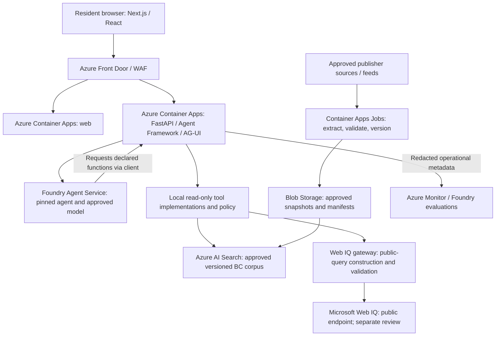

# BC Government service assistant: pilot specification

**Status:** Accepted planning baseline on October 24, 2026. Local implementation
and the limited public Azure pilot were subsequently authorized and deployed.
Resident transactions remain outside the approved pilot.
**Research date:** October 24, 2026.
**Working name:** BC Government service assistant; the deployed interface is labelled as a pilot.
**Product authority:** [PRODUCT.md](../PRODUCT.md).
**Source discovery:** [source-discovery.json](source-discovery.json).
**Current system:** [As-built architecture and diagrams](architecture.md).

The first release has five managed agent bindings and 12 Search chunks from four
explicitly approved snapshots. Web IQ and transactions are not enabled.
Larger corpus quantities and future capabilities below are planning targets,
not claims about the deployed release.

## 1. Recommendation and confirmed scope

Build a task-first government service website, not a chatbot added to a portal.
Use **Next.js + React + the B.C. Design System** for presentation, **AG-UI** for
streaming and structured interactions, **Microsoft Agent Framework + Foundry
Agent Service** for the assistant, and **Azure AI Search** for an owned,
versioned corpus. Host the web application and API in **Azure Container Apps**.

User-confirmed requirements:

- An America.gov-quality experience, adapted to BC Government rather than copied.
- Azure and Foundry as the application backend and AI platform.
- Light and dark modes.
- The twelve supplied source areas must be considered for coverage.
- A polished pilot with real sourced answers, live research, and guided handoffs.
- Real transactions come later, after approved agency integrations.
- Web IQ is acceptable only for approved, non-personal public-information
  queries, subject to privacy review.

The user accepted the framework direction and five-journey scope below as the
planning baseline. Quantities, performance thresholds, package choices and
operational defaults began as proposed targets. The separate deployment,
spending and exact-source approvals for the initial public release do not
approve additional source snapshots, Web IQ processing or resident transactions.
The [as-built architecture](architecture.md) records the current implementation
and its limits; [the implementation contract](implementation-contract.md) defines
the application interfaces.

### Meaning of Azure-native

All application hosting, model inference, owned knowledge, secrets, identity,
and operational telemetry use Azure/Microsoft services. Open-source application
libraries are allowed; they must not introduce an unapproved hosted service.
There is no dependency on Vercel hosting, Vercel AI Gateway, CopilotKit Cloud,
an external model gateway, or a third-party vector database.

Web IQ is a separately reviewed Microsoft-hosted public-web service. Its Azure
resource meters usage but does not put its processing inside our subscription,
VNet, or selected Canadian region. This is an explicit boundary, not a claim
that every Microsoft service has the same residency and privacy terms. [M3]

## 2. Pilot journeys and release boundaries

Start with five complete journeys and approximately **300-500 approved canonical
documents**, rather than a superficial crawl of every page. The document count
is a planning allowance, not an observed corpus size or a substitute for coverage.

| Journey | What the pilot does | Honest stopping point |
|---|---|---|
| Prepare to renew a driver's licence or BCID | Clarifies the task, retrieves current ICBC guidance, builds an ID/preparation checklist, finds an office that offers the service, and opens the official booking/service page | Does not renew, book, pay, collect licence numbers, or claim appointment availability |
| Find rental assistance | Explains and compares relevant BC Housing programmes with cited criteria; prepares a document checklist and application handoff | No binding eligibility decision, application submission, income-document upload, or bank details |
| Understand MSP and PharmaCare next steps | Distinguishes medical coverage from drug coverage, explains current application steps, and routes to the correct official service | No PHN, tax identifiers, treatment recommendation, or enrolment submission |
| Find primary care | Explains the Health Connect Registry, identifies official registration and support routes, and provides service navigation | No clinician-availability promise, diagnosis, or collection of registration details |
| Find a Service BC location that can actually help | Filters locations by required service and municipality; shows published hours, exclusions, contact, and source date | No assumption that every office offers every service or that published hours mean live availability |

Wave 2 adds childcare/income/disability support navigation, WorkBC training and
employment services, employer responsibilities, and provincial tax guidance.
BC Laws becomes a controlled legal-reference layer only after its access and
licensing gate is resolved. All twelve areas appear in the source registry from
the outset, including deferred and blocked sources.

The pilot is primarily anonymous. It does not need a citizen account to answer
questions. Save/resume across devices, document uploads, notifications, voice,
and transactional identity are separate increments, not hidden MVP requirements.

## 3. UX and visual specification

### Direction: an approachable BC service front door

The visitor's task is to **operate**: find an answer, understand evidence, and
make progress. Borrow America.gov's simplicity, generous composition, inviting
composer, and smooth transition into conversation. Do not reproduce its code,
photographs, wording, logo, or distinctive assets.

Use approved BC branding and BC Sans. BC's current typography guidance requires
BC Sans for new government digital services and includes Indigenous-language
character support. Start with official design tokens and accessible components;
extend them for chat rather than replacing the whole system with a generic
chatbot theme. [B13][B14][B15]

### Homepage

- Compact BC identity, visible pilot label, help, and Light / Dark / System control.
- One clear heading, such as "How can we help you today?" as proposed copy.
- A generous centred composer with a visible submit button and concise privacy
  guidance. Do not show microphone/upload controls until those capabilities work.
- A small set of task prompts tied to implemented journeys, not a ministry list.
- BC imagery from approved, licensed assets: real communities and people, not
  fabricated government service illustrations or unlicensed America.gov images.
- A conventional "Browse services" route and human-help links remain available.

### Conversation and task workspace

The composer transitions into a readable conversation. On wide screens, a task
panel opens beside it for checklists, programme comparisons, locations, and
handoffs. On narrow screens, the same content opens inline or as an accessible
sheet; it must never compete with a second independently scrolling chat column.

Answers lead with a short, useful conclusion, then next steps and sources.
Long content expands progressively. Sources remain inspectable while the user
compares services or edits task answers.

The signature interaction is **question to plan**: "I need to renew my licence"
becomes a visible, cited preparation checklist and an official next step.
It must not turn into an unexplained sequence of autonomous actions.

### Approved component family

| Component | Contract |
|---|---|
| Composer | Explicit label; multiline input; send/stop; preserved unsent text on recoverable errors |
| Answer | Structured headings and lists; sanitized Markdown; no model-authored executable HTML |
| Source card | Publisher, page title, canonical URL, source date when known, retrieval/check date, and relevant section |
| Programme comparison | Criteria and differences backed by source IDs; unknown fields stay unknown |
| Task checklist | Completed/pending steps; each step distinguishes information, preparation, or external action |
| Location card | Services offered and explicitly unavailable, municipality, published hours, official contact and link |
| Research status | Real events such as "Searching official BC sources"; never fabricated progress or hidden reasoning |
| Handoff card | Agency, destination domain, reason for leaving, information to prepare, and what remains uncompleted |
| Feedback | Optional, with notice about what will be sent; no automatic transcript upload |

Generative UI means choosing and populating these approved components through
validated schemas. The model cannot generate scripts, arbitrary forms,
unrestricted iframes, payment controls, or new transaction capabilities.

### Light and dark modes

Both modes are first-class designs, not colour inversion. Map official BC tokens
into semantic roles for page, raised surface, text, border, link, focus, and
status. Proposed light mode uses clean light surfaces and BC blue; proposed dark
mode uses deep blue/slate surfaces with readable layered contrast. Use BC gold
sparingly and only where contrast works. Exact extensions require brand review.

System preference is the initial default. An explicit local preference overrides
it, persists without storing chat, and is applied before paint to avoid a theme
flash. Sources, menus, input controls, errors, sheets, and loading states must
all work in both modes. Do not assume the existing BC library supplies a complete
dark theme for every component.

### Accessibility and interaction acceptance

- Target **WCAG 2.2 AA**; BC guidance requires WCAG Level AA. [B13]
- Keyboard-only completion, visible focus, labelled inputs, semantic headings,
  and screen-reader testing in both themes.
- Announce meaningful progress and completed sentences, not every streamed token.
- Respect reduced motion; no auto-rotating hero required to understand the page.
- Design for 320 CSS-pixel reflow and 400% zoom; aim for 44-by-44-pixel controls.
- Do not force scrolling when the reader has scrolled back. Provide a new-content
  indicator and a deliberate jump-to-latest action.
- Support default, thinking, retrieving, streaming, cancelled, rate-limited,
  disconnected, unavailable source, conflicting evidence, and no-answer states.
- No-JavaScript and AI-unavailable states retain service links and contact routes.
- English is the proposed initial editorial language, not a confirmed limitation.
  Build localization foundations now; approve additional languages with domain
  reviewers. Label machine translations and retain original-source access.

## 4. Framework and service decisions

| Layer | Proposed choice | Reason and boundary |
|---|---|---|
| Web app | Next.js App Router, React, TypeScript | One app for public pages, chat, task routes, and later authenticated journeys; server-render the shell and load chat progressively |
| Design | B.C. Design System, BC Sans, semantic CSS tokens; Tailwind optional | Accessible provincial identity without losing custom layout and interaction polish |
| Chat transport | AG-UI over HTTP POST/SSE | Documented Microsoft Agent Framework integration for text, tools, state, and approvals |
| React chat bindings | Self-hosted CopilotKit headless bindings with custom BC components | A documented AG-UI integration path; do not use its cloud service or accept its default appearance as the final UX |
| API and protocol adapter | Python/FastAPI + Microsoft Agent Framework AG-UI integration | Thin Azure-hosted adapter, validation, cancellation, source handling, and local tool policy |
| Assistant definition | Versioned Foundry Agent Service prompt agent | Foundry owns the model, instructions, and tool declarations; the app connects through `FoundryAgent` |
| Model and embeddings | Approved Foundry deployments | Select against quality, language, geography, latency, quota, and cost; no arbitrary model/version promise |
| Owned retrieval | Azure AI Search, hybrid keyword/vector retrieval with semantic ranking | Controlled source filters, evidence metadata, and measurable retrieval quality |
| Live research | Microsoft Web IQ Search/Browse through a restricted server-side tool | Optional at runtime until access, terms, and privacy approval are complete |
| Ingestion | Azure Container Apps Jobs, Blob Storage, and a queue | Controlled acquisition, extraction, change detection, and indexing; not a general unbounded crawler |
| Hosting | Azure Container Apps for web and API; Azure Front Door/WAF for the public edge | Azure-only application runtime; verify SSE through the complete deployed path |
| Identity and secrets | Managed Identity, Azure RBAC, Key Vault when a secret is unavoidable | Use an explicit production credential; no cloud credentials in the browser |
| Observability | Azure Monitor/Application Insights + OpenTelemetry; Foundry evaluations | Metadata-first telemetry and evaluated releases rather than logging complete conversations |
| Optional later services | Durable Functions, Cosmos DB, Azure Managed Redis, Azure Speech | Add only for approved durable workflows, storage, scale, or voice requirements |

**AG-UI is an open protocol, not a Microsoft-owned UI framework. CopilotKit is
open-source software, not an Azure service.** The Microsoft-native part is
Foundry, Agent Framework, Azure hosting, identity, and data services. [M1][M2]

The Vercel AI SDK would still run on Azure. It is not rejected for technical
incompatibility. AG-UI is preferred here because guided tasks, approvals, and
stateful UI are central to the requested experience and Microsoft documents the
integration. It is not inherently safer; policy is enforced on the server.

Astro remains a good alternative for a mainly informational website with a chat
island. Next.js is proposed because this product is expected to become a
multi-step service application. Do not add both frameworks.

Before committing to packages, spike the selected Python/Foundry/AG-UI and React
versions together. Microsoft currently documents some .NET integrations with
prerelease packages and some hosted-session surfaces as preview. Do not infer
feature parity or maturity across SDKs. If the preferred bindings fail the spike,
retain the BC React components and use a small AG-UI client adapter rather than
changing the whole backend. [M1][M2]

## 5. Runtime architecture and ownership

The diagram describes logical components, not a commitment to separate deployed
microservices for every box. The tool policy layer can live in the API process.

Foundry owns the assistant definition. The API owns session authorization,
validation, read-only tool implementation, evidence tracking, and conversion to
AG-UI. There must not be two independent planners interpreting the same task.

For a Foundry prompt agent, local function implementations must match functions
already declared in the stored agent version. Passing a callable at runtime
does not register a new service-side tool. Hosted tools and MCP connections are
configured on the agent definition, not attached opportunistically by the browser.
Pin agent versions and test tools together. [M2]

Start with one assistant and typed tools, not a swarm of separately deployed
"housing", "health", and "licensing" agents. Domain modules initially contain
source filters, journey definitions, reviewed rules, and evaluation cases.

### Request flow

1. Validate input, size limits, anonymous session binding, origin, and rate budget.
2. Classify the task and data sensitivity; load only applicable approved sources.
3. Retrieve evidence before producing a substantive service answer.
4. If fresh research is needed, pass only an approved public-query construction
   to the Web IQ tool. Never forward the transcript or a free-form model query.
5. Foundry produces a sourced answer and typed task artefacts.
6. Validate citations, task schema, URLs, and critical factual fields.
7. Stream useful progress and answer content; hold high-risk rates, deadlines,
   and eligibility assertions until their evidence is checked.
8. End with an honest next step. A handoff is not a completed agency transaction.

Use standard AG-UI events for messages, runs, tools, and state. The Python
integration documents message-linked `CUSTOM` events named `annotations` for
citations; preserve those even when annotations arrive after text. Citations are
application state, not something a final transcript snapshot necessarily replays.
Only show a final answer as complete after the run's terminal event. [M1]

Proposed application endpoints are an AG-UI streaming endpoint, cancellation by
server-authorized run ID, and read-only capability/source-status endpoints.
Their exact routes are an implementation decision; none exists today.

SSE must not be cached or buffered at the web proxy, API, ingress, or edge.
Test cancellation propagation and actual first-chunk delivery in Azure, not just
localhost. A broken stream is not automatically safe to replay: future write
operations need idempotency and reconciliation.

## 6. Source discovery: findings that change the design

This was a **bounded discovery scrape**, not full ingestion. Public landing pages
and selected service pages were fetched; robots policies and the main government
sitemap were inspected. Extractors sometimes returned only footer or FAQ content,
so delivered HTML was also examined where necessary. No logins, forms, payments,
or browser transactions were attempted.

The two government page sitemaps listed **10,000 + 7,688 = 17,688 URL entries**
at inspection. These are discovery entries, not unique approved documents,
current pages, or material already indexed. Asset sitemaps were identified but
not crawled. The supplied government topic seeds overlap the main root.

| Supplied source | Observation | Ingestion decision |
|---|---|---|
| Main government content root | Redirects to `/gov/content/home`; topic navigation and page/asset sitemaps are available | Primary discovery root; tag topics and deduplicate rather than crawl each seed independently |
| Service BC supplied URL | Returns 404; a current sitemap-listed replacement was fetched successfully | Replace seed with the canonical URL in the registry; extract office-specific service exclusions |
| Housing and tenancy | Accessible; tenancy guidance distinguishes stages and dispute resolution | Wave 1 selected renter/service pages; retain contextual exceptions |
| Health | Accessible; MSP and PharmaCare are distinct branches | Wave 1 administrative navigation, not personalized medical advice |
| Family and social supports | Accessible; income assistance links to applications, service channels, and changing payment dates | Wave 2; time-sensitive fields need explicit refresh rules |
| Employment/business | Topic root accessible; employer-page simplified extraction was incomplete | Wave 2; validate extraction before publication; don't index page furniture as guidance |
| Taxes | Accessible; tax updates include disruption/deadline guidance | Wave 2; attach tax year, effective date, and update provenance where stated |
| BC Housing | Root exposes an update-pause notice, with content stated current to September 22, 2026; RAP service material is available | Wave 1 selected programmes; carry the publisher freshness notice and verify complete eligibility sections |
| ICBC | Delivered renewal HTML includes office-visit/ID guidance, but some modules say "Loading..." | Wave 1; approved rendered extraction or publisher feed; never count partial HTML as complete |
| WorkBC | Homepage returned content; `/robots.txt` returned an HTML maintenance notice | Register source, but pause bulk crawl until a valid policy/approved feed is available |
| HealthLink BC | Accessible; Health Connect Registry describes registration and human-help routes | Wave 1 navigation; PHN/address/contact are supplied only to the official service, not this pilot |
| BC Laws | Robots permits named search bots but disallows general crawlers | No general content scrape; obtain approval for CiviX/XML or publisher export and confirm licence terms |

Important source-specific lessons:

- Service BC office capability varies. For example, the inspected source explicitly
  marks ICBC licensing unavailable at some offices; "nearest office" alone is wrong.
- ICBC's sampled renewal page directs people to bring accepted ID to a licensing
  office. The pilot should support preparation and handoff, not promise online renewal.
- Health Connect Registry asks for sensitive registration details. Explain the
  requirements and link to registration without collecting those details.
- A 200 response can be a maintenance page; a visible page date is not a legal
  effective date; a sitemap timestamp is not proof that a fee was reverified.

The source inventory records exact seeds, replacement URLs, and extraction
limitations. These observations are dated, not permanent claims about the sites.

## 7. Two independent information pipelines

### A. Owned, maintained BC corpus

Acquire public content directly from approved publisher endpoints, sitemaps,
exports, and licensed feeds. Run the pipeline in Azure. Azure AI Search indexes
our staged documents; its blob indexer is not a general website crawler. [M5]

Pipeline:

1. **Register:** owner, allowed hosts/path prefixes, licence, robots policy,
   acquisition method, category, freshness class, and escalation contact.
2. **Discover:** sitemap/approved feed first. Do not follow every external link
   merely because it occurs on a government page.
3. **Fetch:** identifiable crawler, initially one in-flight request per host and
   one request per second unless the publisher allows otherwise; conditional
   requests, bounded retries, `Retry-After`, timeouts, and size limits.
4. **Extract:** preserve headings, tables, lists, links, warnings, and explicit
   exclusions. Use rendered extraction only where approved and necessary.
   Use Azure Document Intelligence for permitted scanned PDFs.
5. **Normalize:** canonical URLs, aliases, duplicate hashes, language, issuer,
   service IDs, attachments, version dates, and extraction-quality flags.
6. **Review:** quarantine maintenance/error/partial pages, unexpected content
   changes, prompt-like instructions, and incomplete high-risk rules.
7. **Chunk:** section-aware units that preserve a criterion and its exceptions;
   do not split eligibility exclusions or table headers from their values.
8. **Index:** lexical and vector fields, metadata filters, explicit active version,
   and tombstones for deleted or withdrawn sources.
9. **Evaluate and publish:** promotion only after source and retrieval checks;
   retain approved prior versions for rollback under the content retention policy.

Proposed freshness classes: check fees, deadlines, and service notices daily;
service locations daily with expiry when verification lapses; stable explanatory
guides weekly. Publishers can override these values. Use successful fetch/hash
checks and review workflows, not only page modification dates.

For legal material, separately record publication, consolidation/currency date,
provision effective date, repeal/expiry, and historical version. A law being
published or a bill receiving assent does not prove every provision is in force.
Never substitute a historical consolidation for current law without a visible
as-of label. Confirm the BC Laws XML/API contract and permitted licence before use.

### B. Web IQ live research

Web IQ finds public evidence; it is not an LLM, workflow engine, general browser
operator, or our indexing service. Search discovers relevant passages; Browse
retrieves a known URL. Neither is a substitute for an ICBC transaction API. [M3][M4]

Required policy:

- Enable only after subscription/AppID access, contract, privacy, and egress approval.
- Use Entra/Managed Identity bound to the Web IQ AppID; this is separate from
  Azure RBAC and the metering resource.
- Construct public queries from approved topics and coarse geography; do not
  forward free text and rely solely on a best-effort PII detector to make it safe.
- Block health histories, names, exact addresses, PHNs, licence numbers, tax data,
  credentials, attachments, and resident-specific eligibility details.
- Enforce domain constraints and verify returned and redirected hosts, schemes,
  canonical URLs, and paths independently. `site:` alone is not a security boundary.
- Use Search and Browse only. Do not use beta auto-research or arbitrary tools
  simply because the AppID supports them.
- Bound calls, response size, elapsed time, and token consumption.
- Render clickable original-source citations and distinguish publisher update
  dates from Web IQ's crawl date. No missing timestamp is silently filled in.
- Keep results transient for the current request/workflow. Do not feed Web IQ
  content, response caches, or a harvested URL database into the owned index.
- Do not silently enable a different commercial search provider if Web IQ fails.
  Fall back to approved indexed content with its age, or provide a direct handoff.

Current Microsoft documentation says Web IQ has **no Private Link, no
region-specific residency commitment, default query logging, and separate terms
outside the Microsoft Products and Services Data Protection Addendum**.
Zero Query Logging requires individual approval; it is not an assumed setting.
Its storage exceptions are narrow and do not authorize a derivative search
corpus. The pilot uses the transient-processing path rather than treating
possible history/work-product exceptions as general permission. [M3]

Do not retain Web IQ tool payloads automatically in Foundry conversations,
application caches, diagnostic traces, or evaluation datasets. Verify service
persistence settings end-to-end; if transient handling cannot be demonstrated,
keep that feature disabled pending an approved design.

## 8. Knowledge and task data contracts

| Entity | Required information |
|---|---|
| Source | Publisher, authority scope, seed/canonical URLs, permitted acquisition, licence, robots status, owner, refresh policy |
| Document version | Stable ID, canonical URL, title, language, category, hash, fetched/checked timestamps, publisher date if supplied, extraction method, completeness, status |
| Evidence chunk | Document-version ID, section/page locator, text, related exceptions, language, source authority, validity metadata |
| Programme | Official name, service owner, sourced criteria, exclusions, steps, channel, fees/deadlines with date context, required-document descriptions |
| Location | Publisher location ID, address, municipality, services supported/excluded, published hours, official link, verification timestamp |
| Journey | Version, safe inputs, required evidence, allowed transitions, output components, handoff rules, capability limits |
| Run | Server-authorized session/run ID, agent version, source versions, status, tool budgets, cancellation, metadata-only telemetry |

Programme/location records are derived claims, not a second independent truth.
Every factual field links back to evidence and its validity context. Unknown and
not-applicable are separate states. Canadian dollars, BC service jurisdiction,
and relevant tax/service periods must be explicit when money or deadlines appear.

Authority rules distinguish legislation, administering-agency guidance, service
directories, and notices. A Crown corporation may be authoritative for its own
service even without a `gov.bc.ca` hostname. Source disagreements are surfaced
or escalated; the model must not resolve them by sounding confident.

## 9. Agent tools and future workflows

Pilot tools:

| Tool | Permissions and output |
|---|---|
| Search approved corpus | Read-only; topic/version filters; returns evidence and completeness |
| Read approved source | Read-only; publisher allowlist, SSRF controls, bounded retrieval |
| Find service locations | Read-only; filters capabilities before geography |
| Build a preparation plan | Deterministic journey schema with cited steps; no external side effects |
| Research public web | The constrained Web IQ path above; denied by default |
| Prepare handoff | Validated official destination and clear next-step description |

Tool permissions are enforced outside the model. A retrieved page, a tool
response, or a client-provided state update cannot grant authority.

Proposed journey states:

`discover -> clarify -> retrieve -> present options -> prepare -> handoff`

Future transactional states add:

`authenticate -> review -> explicit approval -> submit -> verify receipt`

Approval binds the user, agency, operation, exact payload hash, expiry, and
idempotency key. Editing the payload invalidates approval. A timeout after
submission triggers reconciliation against the agency system before retry.
Show success only after an authoritative receipt; preserve failures as failures.

Use approved agency APIs first. Where permitted, browser automation is a later
integration with explicit scopes and human handoff for authentication, MFA,
CAPTCHA, legal consent, and unavailable APIs. Web IQ is not that browser-automation
layer. General project authorization does not replace a resident's action consent.

Durable Functions or an equivalent approved Azure workflow service can own
long-running business state. AG-UI state synchronization and an LLM conversation
do not themselves provide durable transaction execution.

## 10. Privacy, identity, safety, and deployment controls

Complete BC's PIA process and security assessment before public use. Confirm
collection authority, notices, records schedules, disclosures, supplier terms,
and incident handling with the responsible BC teams. The existing authorization
to plan this project is not evidence those reviews have been completed. [B16]

Proposed pilot defaults:

- No sign-in to ask questions; no intentionally collected direct identifiers.
- Conversation in browser memory; no local-storage transcript or account history.
- Only theme/language preferences persist locally.
- No prompt, response, attachment, or tool-body logging by default.
- No transcript-bearing URLs, query strings, browser analytics, or session replay.
- Any Foundry response/session persistence is explicitly configured and reviewed;
  do not advertise "nothing is stored" without verifying provider behavior.
- Optional feedback has a disclosure and retention policy; it is not automatically
  a training/evaluation dataset.
- Separate anonymous usage from administrative access. Admins use Entra ID/RBAC.
- Later citizen authentication uses an approved BC Services Card/BC identity
  integration; Entra workforce identity is not automatically its replacement.

Treat every fetched page, PDF, Markdown fragment, and tool result as untrusted
data. Use tool allowlists, URL/redirect validation, SSRF protection, schema
validation, output sanitization, least privilege, bounded execution, and applicable
Foundry safety controls. Safety filters supplement these controls; they do not
prove retrieved instructions are safe.

Health, benefits, tenancy, and tax responses are information/navigation, not
clinical advice or binding legal/eligibility decisions. Review emergency routing
copy with domain owners. Urgent help must not wait for a long research workflow.

### Geography and residency

Propose Canada-hosted core resources where supported and approved. Validate
actual model/SKU availability, Foundry agent/session storage, search, backups,
logging, optional speech/document services, and edge behavior before choosing
regions.

A Canadian resource location alone does not ensure Canadian inference:
Global deployment types can process internationally; data-zone types follow
their specified zone; Standard/Regional Provisioned use the approved Azure
geography under current documentation. Check each model and service explicitly.
Web IQ remains the separately approved exception described above. [M6]

### Keep the initial architecture proportionate

Start with one web app, one API/adapter, one Foundry assistant, one search service,
Blob Storage, ingestion jobs, a queue, edge protection, and monitoring. Add APIM
if shared API governance requires it. Add Redis, Cosmos DB, multiple agents,
multi-region failover, and durable transactions only for a demonstrated need.

No cost figure is asserted without a region, traffic envelope, model choice,
corpus size, and approved service tier. Track costs by successful user task,
including ingestion, embeddings, search, model tokens, Web IQ, hosting, and logs.

## 11. Release gates and measurable acceptance

These are **proposed targets**, not results or guarantees.

| Area | Pilot acceptance gate |
|---|---|
| Source coverage | Reviewed coverage matrix for every pilot journey; every active source has an owner, permitted route, freshness class, and extraction checks |
| Retrieval | At least 95% top-5 evidence recall on a versioned, domain-reviewed answerable question set |
| Answers | All service-critical claims have valid evidence; at least 95% grounded/appropriate answers on the reviewed set; zero unsupported critical fee/deadline/eligibility claims in the release suite |
| Citation integrity | No fabricated or out-of-scope citations; every citation resolves to the document version or clearly labelled live result actually used |
| Abstention | Test missing, stale, conflicting, unavailable, and out-of-scope sources; the assistant abstains or hands off instead of inventing |
| Workflow truth | All five journeys finish with a useful plan/handoff; none reports a transaction or booking it did not perform |
| Privacy/tool policy | Tests demonstrate no direct identifiers sent to Web IQ, no default transcript logging, and no write-capable pilot tools |
| Accessibility | Keyboard and screen-reader journeys pass in both themes; no unresolved critical/serious automated findings; manual WCAG review completed |
| Web performance | Target p75 LCP <=2.5s, INP <=200ms, CLS <=0.1 on representative mobile conditions |
| Response performance | Target p95 first useful indexed guidance <=10s; bounded public research <=25s or explicit partial/unavailable result; measure warm/cold separately |
| Resilience | Cancellation, stream interruptions, quota limits, upstream 202/429/5xx, partial extraction, source withdrawal, and disabled Web IQ handled visibly |
| Approval | Product owner, source owners, accessibility, privacy, security, and operations sign off before a public pilot |

Create an initial evaluation set of roughly **200 questions**, stratified by
journey and risk, plus adversarial and source-failure cases. Include the discovered
Service BC exclusions, ICBC office handoff, unsupported-online-renewal requests,
dated payment information, licence/PHN leakage attempts, and maintenance pages.
Expand until each critical rule and failure mode has explicit coverage.

Evaluate each model/agent/prompt/index release as a versioned combination. Use
Foundry evaluations plus deterministic citation, URL, schema, privacy, and
workflow assertions. Human domain review remains necessary; an LLM judge is
not the authority for statutory correctness.

## 12. Delivery sequence

| Phase | Deliverable | Exit condition |
|---|---|---|
| 0. Product and platform decisions | Approved pilot scope, brand assets, source owners, region policy, PIA/security path, Web IQ access/terms decision | No unresolved foundational privacy or source-access assumption |
| 1. Design and vertical slice | Responsive homepage and conversation/task workspace in both themes; one real ICBC-guidance journey | AG-UI/Foundry spike works; accessible task and citation interaction approved |
| 2. Trusted knowledge | Controlled acquisition, extraction/versioning, hybrid search, source-health view, first 300-500 approved documents as needed | Coverage and extraction gates pass; rollback demonstrated |
| 3. Complete five journeys | Service-specific cards, plans, location capability filtering, handoffs, and honest failure states | Journey/evidence suite passes |
| 4. Live research and hardening | Restricted Web IQ tool if approved; privacy, safety, operational and performance work | Feature-specific approvals and full pilot gates pass |
| 5. Pilot learning | Controlled release, metadata-based observation, reviewed user research and issue backlog | Evidence supports expansion rather than just page-view growth |
| 6. Agency integrations | Approved identity and APIs, durable state, explicit approvals, receipts, reconciliation | Per-agency authorization and operational readiness; not part of initial pilot |

Do not block the useful indexed-content pilot on BC Laws or Web IQ approval.
Do not silently count either as delivered while disabled.

## 13. Remaining decisions

1. Final public name, approved logo/imagery, and ownership of content/design review.
2. Validate the accepted framework combination in a technical spike and assign
   domain/content owners for the five accepted priority journeys.
3. Azure subscription/landing zone, regional-processing policy, network topology,
   expected traffic, budget ceiling, and service availability.
4. Source-owner permission/feed arrangements for BC Laws, WorkBC, and dynamic ICBC content.
5. Languages and accessibility research cohorts for the public pilot.
6. Exact retention, feedback, records, operational support, and incident policies.
7. Which agency transaction integration should follow the pilot, with named owner
   and supported APIs rather than assumptions about browser automation.

## References

All direct observations are as of the research date. Product documentation and
public service guidance can change; recheck them at implementation and release.

- [B1: BC content root](https://www2.gov.bc.ca/gov/content/home)
- [B2: Canonical Service BC](https://www2.gov.bc.ca/gov/content/governments/organizational-structure/ministries-organizations/ministries/citizens-services/servicebc)
- [B3: Housing and tenancy](https://www2.gov.bc.ca/gov/content/housing-tenancy)
- [B4: Health and drug coverage](https://www2.gov.bc.ca/gov/content/health/health-drug-coverage)
- [B5: Income assistance](https://www2.gov.bc.ca/gov/content/family-social-supports/income-assistance)
- [B6: Employment and business](https://www2.gov.bc.ca/gov/content/employment-business)
- [B7: Tax updates](https://www2.gov.bc.ca/gov/content/taxes/tax-updates)
- [B8: BC Housing](https://www.bchousing.org/) and [Rental Assistance Program](https://www.bchousing.org/housing-assistance/rental-assistance-programs/RAP)
- [B9: ICBC renewal guidance](https://www.icbc.com/driver-licensing/getting-licensed/Renew-your-licence-or-ID)
- [B10: WorkBC](https://www.workbc.ca/) and [robots endpoint](https://www.workbc.ca/robots.txt)
- [B11: Health Connect Registry guidance](https://www.healthlinkbc.ca/find-care/health-connect-registry)
- [B12: BC Laws robots policy](https://www.bclaws.gov.bc.ca/robots.txt); [CiviX API documentation](https://www.bclaws.gov.bc.ca/civix/template/complete/api/index.html) was discovered through search, not tested as an approved feed
- [B13: B.C. Design System](https://digital.gov.bc.ca/bcgov-common-components/design-system/)
- [B14: Typography and BC Sans](https://www2.gov.bc.ca/gov/content/digital/design-system/foundations/typography)
- [B15: Colour and brand guidance](https://www2.gov.bc.ca/gov/content/digital/design-system/foundations/colour)
- [B16: BC Privacy Impact Assessments](https://www2.gov.bc.ca/gov/content/governments/services-for-government/information-management-technology/privacy/privacy-impact-assessments)
- [B17: Government sitemap index](https://www2.gov.bc.ca/sitemap/sitemap_index.xml) and [robots policy](https://www2.gov.bc.ca/robots.txt)
- [M1: Agent Framework AG-UI integration](https://learn.microsoft.com/agent-framework/integrations/by-component/ui/ag-ui/)
- [M2: Agent Framework and Foundry Agent Service](https://learn.microsoft.com/agent-framework/integrations/by-component/agent-services/foundry)
- [M3: Web IQ FAQ, privacy, networking, and storage terms](https://learn.microsoft.com/web-iq/resources/faq)
- [M4: Web IQ quickstart and API behavior](https://learn.microsoft.com/web-iq/get-started/quickstart)
- [M5: Azure AI Search indexers](https://learn.microsoft.com/azure/search/search-indexer-overview)
- [M6: Foundry model deployment types and processing geography](https://learn.microsoft.com/azure/ai-foundry/openai/how-to/deployment-types)

[B13]: https://digital.gov.bc.ca/bcgov-common-components/design-system/
[B14]: https://www2.gov.bc.ca/gov/content/digital/design-system/foundations/typography
[B15]: https://www2.gov.bc.ca/gov/content/digital/design-system/foundations/colour
[B16]: https://www2.gov.bc.ca/gov/content/governments/services-for-government/information-management-technology/privacy/privacy-impact-assessments
[M1]: https://learn.microsoft.com/agent-framework/integrations/by-component/ui/ag-ui/
[M2]: https://learn.microsoft.com/agent-framework/integrations/by-component/agent-services/foundry
[M3]: https://learn.microsoft.com/web-iq/resources/faq
[M4]: https://learn.microsoft.com/web-iq/get-started/quickstart
[M5]: https://learn.microsoft.com/azure/search/search-indexer-overview
[M6]: https://learn.microsoft.com/azure/ai-foundry/openai/how-to/deployment-types
